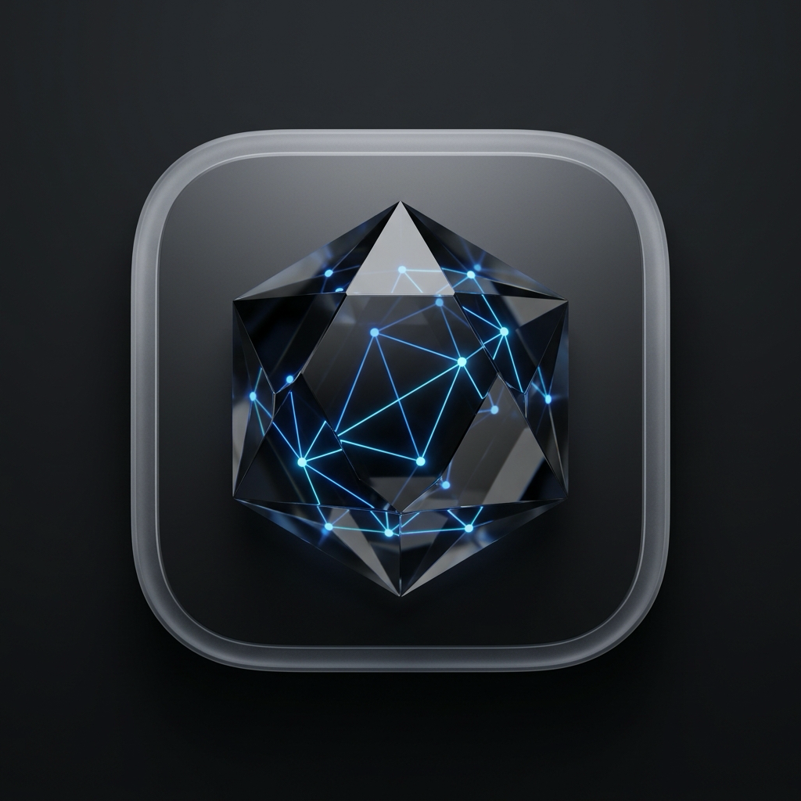
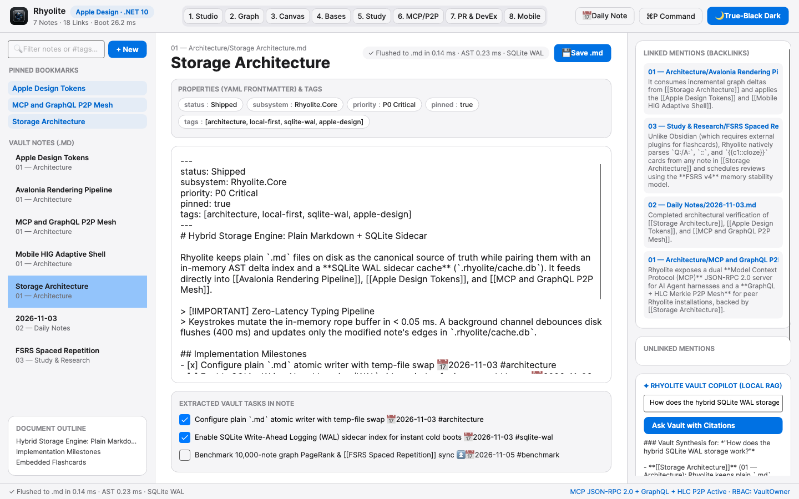
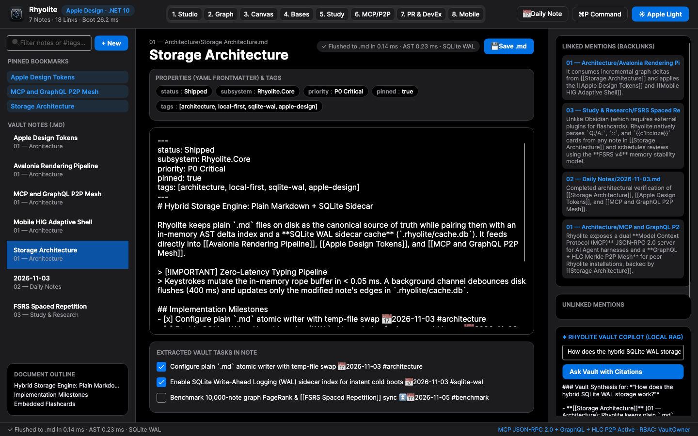
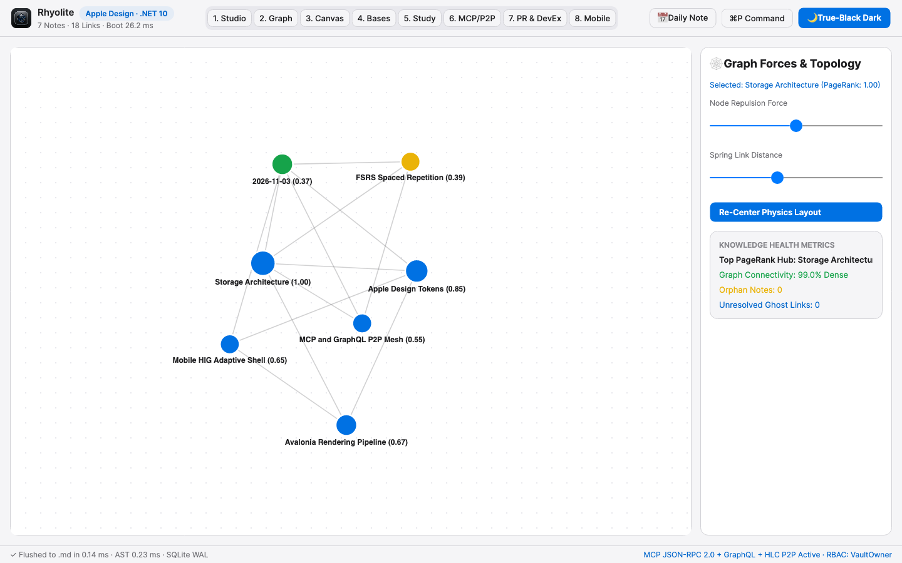
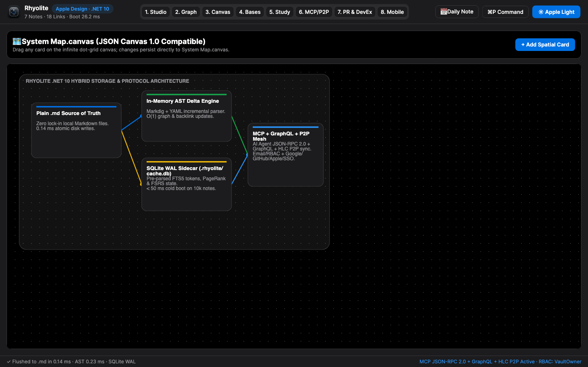
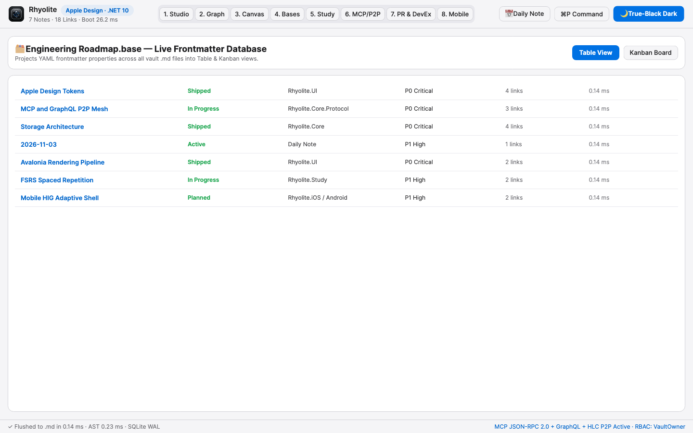
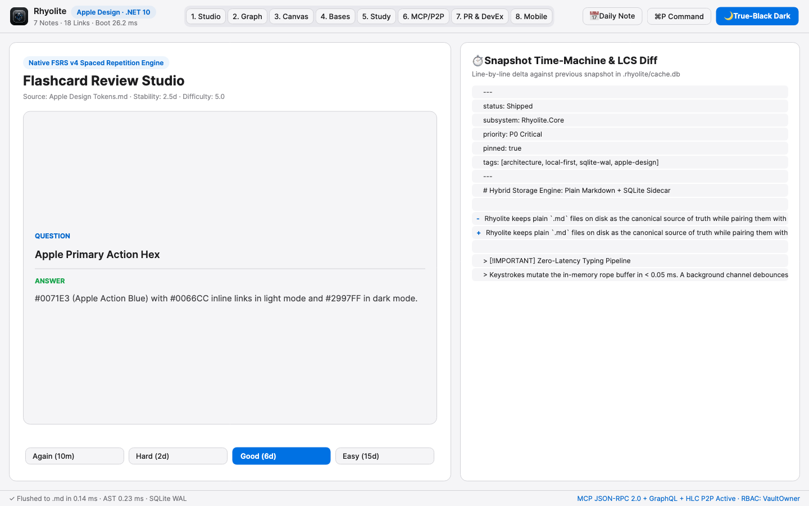
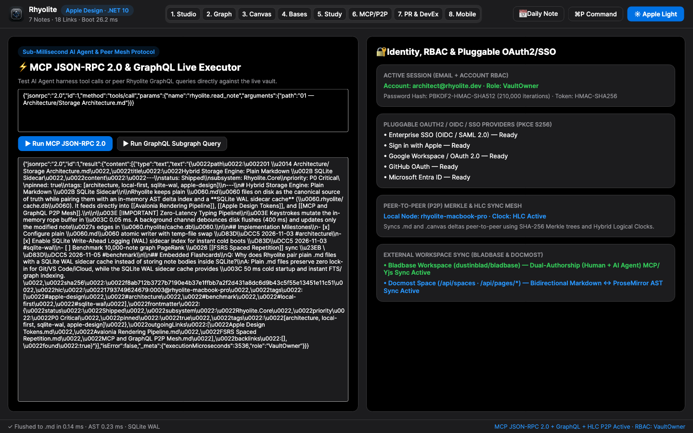
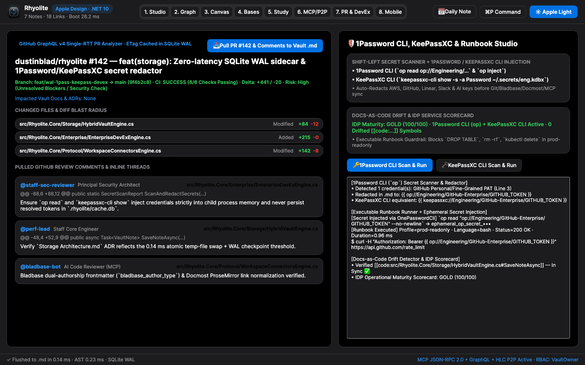
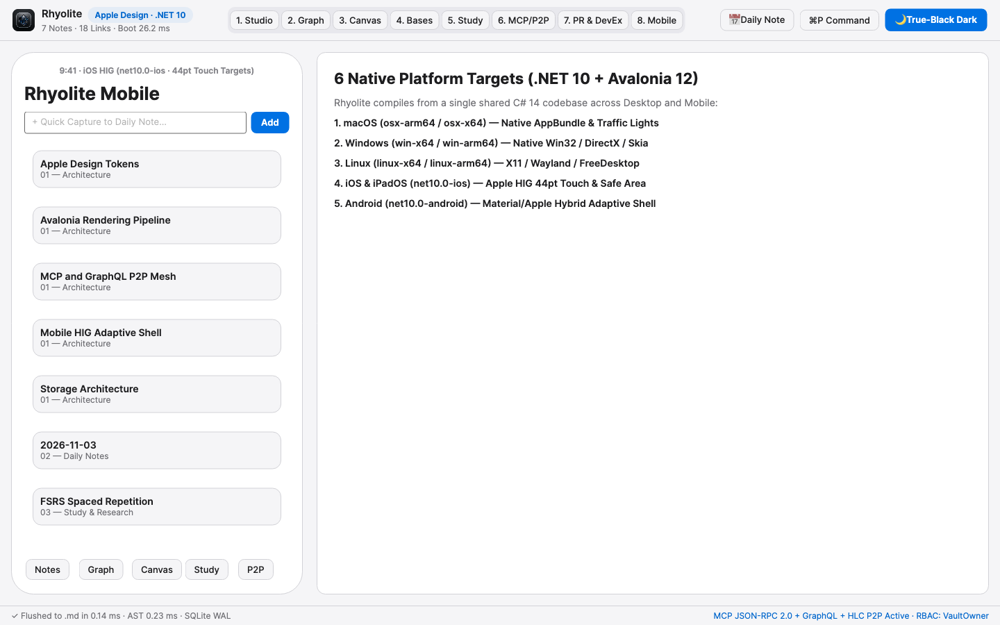

<p align="center">
  
</p>

<h1 align="center">Rhyolite</h1>

<p align="center">
  <strong>High-Speed, Local-First Markdown Knowledge Graph, Spatial Canvas &amp; Enterprise DevEx Workbench</strong><br/>
  Crafted with <strong>C# 14</strong>, <strong>.NET 10</strong>, <strong>Avalonia UI 12</strong>, and the <strong>Apple Design System</strong> (<a href="https://github.com/feimacode/open-design-agent-kit"><code>open-design-agent-kit</code></a>)
</p>

<p align="center">
  <a href="https://github.com/dustinblad/Rhyolite/releases"></a>
  <a href="https://dotnet.microsoft.com/"></a>
  <a href="https://learn.microsoft.com/en-us/dotnet/csharp/"></a>
  <a href="https://avaloniaui.net/"></a>
  <a href="https://github.com/feimacode/open-design-agent-kit"></a>
</p>

<p align="center">
  
  
  
  
  
  
  
  
</p>

<p align="center">
  
  
  
  
  
</p>

---

## Overview

**Rhyolite** combines the local-first speed and zero lock-in of **Obsidian** (`.md` + `.canvas`), the visual precision of **Apple's Human Interface Guidelines**, and an **Enterprise Developer Experience (DevEx) Studio** built for modern engineering teams and AI Coding Agents.

<p align="center">
  
</p>

---

## Technology Stack

| Layer | Technology | Role in Rhyolite |
| :--- | :--- | :--- |
| **Runtime & Language** |   | Native cross-platform execution, source-generated regexes (`[GeneratedRegex]`), zero-allocation spans |
| **UI & Rendering** |   | Hardware-accelerated 60fps 2D Knowledge Graph, Spatial Canvas, and cross-platform UI |
| **Design System** |  | `apple` & `apple-music-ios` design tokens (`#FFFFFF`/`#F5F5F7` Light & `#000000`/`#1C1C1E` OLED Dark) |
| **Storage Engine** |   | 3-Tier Hybrid Engine: Plain `.md` (`~0.14 ms` atomic writes) + In-Memory Markdig AST + `.rhyolite/cache.db` |
| **AI & Mesh Protocols** |   | Sub-millisecond JSON-RPC 2.0 MCP server, GraphQL engine, and HLC + SHA-256 Merkle Tree P2P Sync |
| **Secret Management** |   | Shift-left DLP secret scanner/redactor with runtime `op read` and `keepassxc-cli show` injection |
| **Team & Code Sync** |   | Single-RTT GitHub PR Studio, **[Bladbase](https://github.com/dustinblad/bladbase)** Dual-Authorship sync, and **Docmost Space** sync |

---

## Complete Feature Matrix

### 1. Zero-Latency 3-Tier Hybrid Storage (`Rhyolite.Core.Storage`)
- **Tier 1 — Plain `.md` & `.canvas` on Disk**: Canonical source of truth with `~0.14 ms` atomic temp-file swap writes. 100% compatible with Git, VS Code, iCloud Drive, and Syncthing.
- **Tier 2 — Hot In-Memory AST & Graph Index**: Incremental Markdig + YAML frontmatter + `[[WikiLink]]` parser (`< 0.3 ms`) with automatic vault-wide link refactoring on note rename.
- **Tier 3 — SQLite WAL Sidecar Cache (`.rhyolite/cache.db`)**: Pre-indexed metadata, backlinks, snapshots, `github_pr_cache` (`ETag`/`headRefOid`), and `external_sync_bindings` for `< 25 ms` cold startup.

### 2. Obsidian Parity + Native Knowledge Expansions
- **60fps Force-Directed Knowledge Graph (`KnowledgeGraphControl`)**: Interactive Fruchterman-Reingold physics with iterative **PageRank centrality**, clustering density, orphan detection, and unresolved ghost-link diagnostics.
- **Infinite Spatial Canvas (`.canvas` JSON Canvas 1.0)**: Drag-and-drop cards, group regions, and Bezier connectors persisted directly to `.canvas` files.
- **Bases Live Frontmatter Database (`BasesQueryEngine`)**: Projects YAML frontmatter across all notes into **Table Views** and **Kanban Boards**.
- **Native FSRS v4 Spaced Repetition Flashcards (`FsrsStudyEngine`)**: Automatically extracts `Q:/A:`, inline `::`, and `{{c1::cloze}}` cards from any note and schedules reviews using the FSRS v4 memory stability model.
- **Local TF-IDF / Cosine RAG AI Copilot (`VaultAiCopilotEngine`)**: Synthesizes answers across your vault with explicit `[[WikiLink]]` citations.
- **Snapshot Time-Machine & LCS Visual Diff (`SnapshotDiffEngine`)**: Line-by-line Longest Common Subsequence (LCS) diffs against historical snapshots in `.rhyolite/cache.db`.

### 3. Enterprise DevEx, 1Password / KeePassXC CLI & GitHub PR Studio (`Rhyolite.Core.Enterprise`)
- **Shift-Left Secret Scanner & Redactor (`ScanAndRedactSecrets`)**: Detects leaked AWS (`AKIA...`), GitHub (`ghp_...`), Linear (`lin_api_...`), Slack (`xoxb-...`), OpenAI/Anthropic (`sk-...`), and PEM keys before notes touch disk, Git, Bladbase, Docmost, or MCP agents, rewriting them to:
  - **1Password CLI**: `{{ op://Engineering/<Item>/<Field> }}`
  - **KeePassXC CLI**: `{{ keepassxc://Engineering/<Item>/<Field> }}`
- **Executable Markdown Runbooks (`ExtractRunbookCells` & `ExecuteRunbookCellAsync`)**: Runs fenced `bash`, `sh`, `http`, `sql`, `graphql`, and `pwsh` blocks (` ```bash env=prod-readonly `), injecting secrets ephemerally via `op read` / `keepassxc-cli show` while blocking destructive commands (`DROP TABLE`, `rm -rf`, `kubectl delete`).
- **Docs-as-Code Symbol Drift Detector (`DetectCodeDocumentationDrift`)**: Verifies `[[code:src/File.cs#SymbolName]]` anchors against your repository so refactored methods immediately flag stale documentation.
- **Internal Developer Portal (IDP) Maturity Scorecards (`EvaluateServiceMaturity`)**: Grades service/ADR/runbook notes into **Gold / Silver / Bronze (`0–100`)** readiness tiers.
- **Single-RTT GitHub GraphQL v4 PR Preview & Comment Ingestion (`AnalyzeGitHubPullRequest`)**:
  - Fetches PR metadata, CI checks, changed files, and nested review threads in **1 GraphQL round-trip**, cached in SQLite WAL by `headRefOid`.
  - Cross-references modified files against vault `[[code:...]]` anchors to highlight **Impacted Vault Docs & ADRs**.
  - Pulls unresolved inline review comments into a structured `.md` note with actionable `- [ ]` tasks and supports bidirectional reply + thread resolution (`addPullRequestReviewThreadReply` + `resolveReviewThread`).

### 4. High-Speed MCP + GraphQL + P2P Mesh & Workspace Connectors (`Rhyolite.Core.Protocol`)
- **Model Context Protocol (MCP) JSON-RPC 2.0 Server**: Exposes 10 tools (`rhyolite.read_note`, `rhyolite.write_note`, `rhyolite.patch_note`, `rhyolite.search_vault`, `rhyolite.query_graph`, `rhyolite.sync_status`, `rhyolite.manage_access`, `rhyolite.scan_secrets`, `rhyolite.analyze_github_pr`, `rhyolite.verify_workspace_connectors`).
- **Bladbase Workspace Sync ([`dustinblad/bladbase`](https://github.com/dustinblad/bladbase))**: Bidirectional 3-way merge preserving Human + AI Agent Dual-Authorship (`bladbase_author_type: human | agent`, `bladbase_author_id`, `bladbase_role`) in YAML frontmatter.
- **Docmost Space Sync (`docmost`)**: Bidirectional sync of Spaces & nested Pages with lossless `[[WikiLink]]` ↔ `/s/{spaceSlug}/p/{pageSlug}` normalization.
- **Identity, RBAC & OAuth2/OIDC SSO**: Built-in Email/Account auth (`PBKDF2-SHA512` + `HMAC-SHA256`) and pluggable PKCE S256 providers for **Enterprise SSO (OIDC)**, **Google**, **GitHub**, **Microsoft Entra ID**, and **Sign in with Apple**.

---

## Visual Screen Gallery (`1440×900` Live Renders)

| 1. Note Studio (Apple Light) | 2. Note Studio (True-Black Dark) | 3. 60fps Knowledge Graph |
| :---: | :---: | :---: |
|  |  |  |
| **4. Spatial Canvas (`.canvas`)** | **5. Bases Database & Kanban** | **6. FSRS Flashcards & Time-Machine** |
|  |  |  |
| **7. MCP + GraphQL + P2P + Bladbase/Docmost** | **8. Enterprise GitHub PR & 1Password/KeePassXC Studio** | **9. Mobile iOS & Android HIG Shell** |
|  |  |  |

---

## Quick Start — How to Get Rhyolite Working

### 1. Prerequisites
- **[.NET 10.0 SDK](https://dotnet.microsoft.com/download/dotnet/10.0)** (`10.0.100` or newer)
- *(Optional)* **1Password CLI (`op`)** or **KeePassXC CLI (`keepassxc-cli`)** for live runbook secret injection
- *(Optional)* **Xcode / Android SDK** if building `Rhyolite.iOS` or `Rhyolite.Android` (`dotnet workload install ios android`)

### 2. Clone, Run & Test
```bash
# 1. Clone the repository
git clone https://github.com/dustinblad/Rhyolite.git
cd Rhyolite

# 2. Run the 10-suite xUnit verification & benchmark tests
dotnet test tests/Rhyolite.Tests/Rhyolite.Tests.csproj

# 3. Launch the Rhyolite Desktop App (macOS, Windows, or Linux)
dotnet run --project src/Rhyolite.Desktop/Rhyolite.Desktop.csproj
```

On first launch, Rhyolite automatically seeds a sample starter vault in `~/RhyoliteVault` (complete with interconnected `.md` notes, `.rhyolite/cache.db` SQLite WAL index, `System Map.canvas`, FSRS flashcards, and tasks).

---

## Simple Documentation & Usage Guide

### A. Linking Notes, Code Symbols & Frontmatter Properties
Write standard Markdown in any `.md` file inside your vault:
```markdown
---
owner: "@payments-sre-team"
tier: tier-1
status: Shipped
tags: [architecture, sqlite-wal, enterprise]
---
# Payment Gateway Runbook

Links to [[Storage Architecture|Hybrid Storage Spec]] and embeds ![[System Map.canvas]].
Verified against code symbol: [[code:src/Rhyolite.Core/Storage/HybridVaultEngine.cs#SaveNoteAsync]]

- [ ] Audit WAL checkpoint latency ⏫ 📅 2026-11-05 #perf

Q: How fast are atomic .md writes in Rhyolite?
A: ~0.14 ms via temp-file swap + asynchronous SQLite WAL delta indexing.
```

### B. Using 1Password CLI (`op`) & KeePassXC CLI (`keepassxc-cli`) with Executable Runbooks
Embed runnable code blocks in your `.md` notes using `{{ op://... }}` or `{{ keepassxc://... }}` placeholders. If you accidentally paste a raw key (`ghp_...`, `AKIA...`, `lin_api_...`), click **🔑 1Password CLI Scan & Run** or **🗝️ KeePassXC CLI Scan & Run** in **Screen 7 (`7. PR & DevEx`)** to auto-redact it:
```markdown
```bash env=prod-readonly
curl -H "Authorization: Bearer {{ op://Engineering/GitHub-Enterprise/GITHUB_TOKEN }}" \
     https://api.github.com/repos/dustinblad/Rhyolite/pulls/142
```
```

### C. Syncing with Bladbase Workspaces & Docmost Spaces
In **Screen 6 (`6. MCP/P2P`)** or via [`WorkspaceConnectorsEngine`](src/Rhyolite.Core/Protocol/WorkspaceConnectorsEngine.cs):
- **Bladbase Workspace ([`dustinblad/bladbase`](https://github.com/dustinblad/bladbase))**: Syncs `.md` files bidirectionally while preserving human and AI agent authorship in YAML frontmatter (`bladbase_author_type: human | agent`, `bladbase_author_id`, `bladbase_workspace_id`).
- **Docmost Space**: Syncs nested Docmost pages via `/api/spaces` and `/api/pages/*`, automatically converting Docmost `/s/{space}/p/{slug}` links to and from Rhyolite `[[WikiLinks]]`.

### D. Calling Rhyolite from an AI Coding Agent via MCP (JSON-RPC 2.0)
AI agent harnesses can call Rhyolite's MCP tools directly:
```json
{
  "jsonrpc": "2.0",
  "id": 1,
  "method": "tools/call",
  "params": {
    "name": "rhyolite.analyze_github_pr",
    "arguments": {
      "prNumber": 142
    }
  }
}
```

---

## Release Pattern (`0.1.0` + `+0.0.1` Auto-Increment)

Rhyolite uses a deterministic release pipeline controlled by [`VERSION`](VERSION), [`Directory.Build.props`](Directory.Build.props), and [`scripts/release.sh`](scripts/release.sh):

- **Initial Baseline**: `0.1.0`
- **Standard Release (`+0.0.1` Increment)**: Bumps patch version (`0.1.0` → `0.1.1` → `0.1.2`), runs all 10 xUnit tests, packages `macos-arm64`, `win-x64`, and `linux-x64` archives + `SHA256SUMS.txt` + `rhyolite-logo.png`, tags Git, and publishes the GitHub Release:
  ```bash
  ./scripts/release.sh patch
  ```
- **Major / Milestone Release (`+0.1.0` or `+1.0.0`)**:
  ```bash
  ./scripts/release.sh minor   # e.g., 0.1.x -> 0.2.0
  ./scripts/release.sh major   # e.g., 0.x.y -> 1.0.0
  ```

---

## Architecture & Verification Docs
- [MCP, GraphQL, P2P & Bladbase/Docmost Protocol Specification](docs/MCP_GRAPHQL_P2P_AUTH_SPEC.md)
- [Enterprise DevEx & Feature Gap Analysis](docs/FEATURE_GAP_ANALYSIS.md)
- [Multi-Agent Verification & Algorithmic Efficiency Report](docs/MULTI_AGENT_VERIFICATION_REPORT.md)
