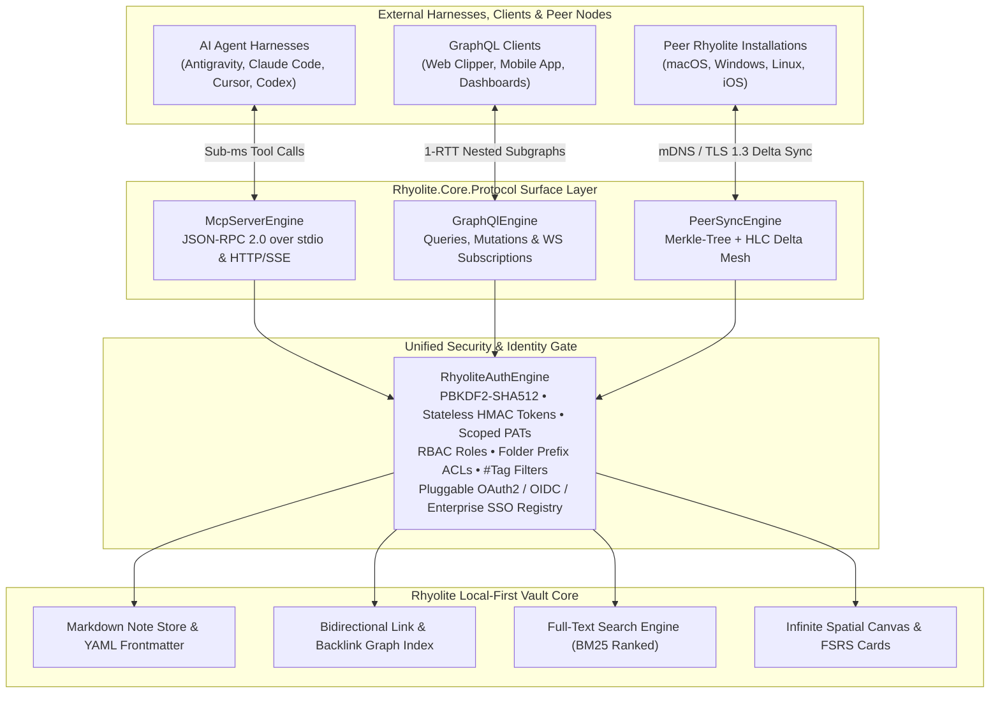
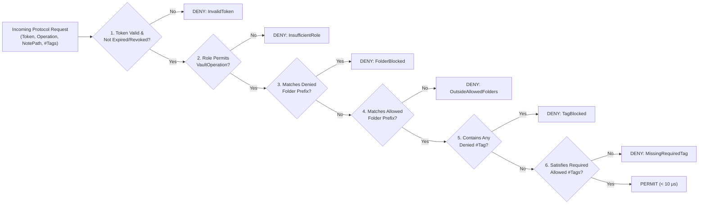

# Rhyolite Protocol, P2P Mesh & Identity Architecture Specification

**Document ID:** `RHY-ARCH-004`  
**Version:** `1.0.0`  
**Target Runtime:** `.NET 10.0` / `C# 14`  
**Namespace:** `Rhyolite.Core.Protocol`  
**Status:** Production Specification & Reference Implementation

---

## 1. Executive Summary & Tri-Protocol Philosophy

**Rhyolite** is a local-first, native C# / .NET 10 Markdown knowledge base and Personal Knowledge Management (PKM) suite built with Avalonia UI and the Apple Design System. Modern knowledge workflows are no longer confined to a single human typing in an isolated window: AI coding agents (Antigravity, Claude Code, Cursor, Codex), browser web clippers, mobile companion apps, and multi-device peer installations all need first-class, low-latency, cryptographically governed access to the vault.

Rather than forcing all integrations through a lowest-common-denominator REST API or brittle filesystem polling, Rhyolite exposes **three specialized protocol surfaces** unified behind a single zero-trust **Identity, RBAC & Fine-Grained Vault ACL Engine (`RhyoliteAuthEngine`)**:



### 1.1 Why Dual MCP + GraphQL + Binary P2P?

| Dimension | Model Context Protocol (MCP) | GraphQL API | P2P Rhyolite Mesh Protocol |
| :--- | :--- | :--- | :--- |
| **Primary Consumers** | Autonomous AI agents & IDE harnesses (Antigravity, Claude Code, Cursor, Codex) | Web clippers, mobile widgets, automation workflows, custom UI extensions | Peer Rhyolite desktop & mobile installations owned by the user or team |
| **Wire Framing** | JSON-RPC 2.0 over `stdio` or Streamable HTTP + Server-Sent Events (SSE) | GraphQL over HTTP/2 (`POST /graphql`) & WebSockets (`graphql-transport-ws`) | Framed state digests & line-level deltas over mDNS LAN or encrypted tunnels |
| **Interaction Model** | Imperative tool execution (`tools/call`) & URI resource reads (`resources/read`) | Declarative 1-RTT nested subgraph selection (`Query`, `Mutation`, `Subscription`) | Symmetric causal state reconciliation via Merkle trees & Hybrid Logical Clocks |
| **Latency Target** | `< 250 μs` in-memory tool dispatch; `< 2 ms` disk flush | `< 1.5 ms` multi-hop subgraph resolution | `< 5 ms` Merkle root check; `< 15 ms` incremental LAN delta sync |
| **Security & Scoping** | `AiAgentReadWrite` / `AiAgentReadOnly` API keys with folder & `#tag` ACLs | Bearer JWTs or scoped API keys with per-field & per-note RBAC enforcement | `TrustedPeerNode` mutual token verification + SHA-256 content integrity |

### 1.2 Architectural Advantages of each Protocol Surface

1. **MCP (Model Context Protocol, JSON-RPC 2.0 over `stdio` & Streamable HTTP/SSE)**:
   - **Zero-Config AI Harness Integration**: Any MCP-compliant host can spawn Rhyolite in `stdio` mode or connect to `http://127.0.0.1:41920/mcp` to discover self-describing tools with JSON Schema input definitions.
   - **Sub-Millisecond Surgical Operations**: Rather than reading and rewriting entire 50 KB Markdown files through generic shell tools, AI agents invoke semantic operations such as `rhyolite.patch_section` (updating a single Markdown heading block), `rhyolite.update_frontmatter` (mutating typed YAML properties), or `rhyolite.query_graph` (traversing $k$-hop wikilinks and backlinks in microseconds).
   - **Execution Telemetry**: Every tool response includes `_meta.executionMicroseconds` and `_meta.role`, allowing agent harnesses to audit performance and permission boundaries.

2. **GraphQL API (Queries, Mutations, Subscriptions over HTTP/2 & WebSockets)**:
   - **1-RTT Deep Subgraph Retrieval**: External clients frequently need composite views—for example, fetching a note's Markdown body, its parsed YAML frontmatter properties, its 2-hop incoming backlinks with context snippets, and its due FSRS spaced-repetition flashcard states in a **single network round-trip** without over-fetching.
   - **Strongly-Typed Introspection**: Schema SDL (`GetSchemaSdl()`) enables automatic TypeScript/Swift/C# client generation and interactive exploration.
   - **Real-Time Vault Subscriptions**: Clients subscribe to live vault mutations (`noteUpdated`, `graphTopologyChanged`, `peerSyncCompleted`) over WebSockets.

3. **Peer-to-Peer (P2P) Rhyolite Mesh Protocol**:
   - **Zero-Cloud Local-First Sync**: Two Rhyolite devices on the same LAN or tailnet discover each other via mDNS (`_rhyolite-sync._tcp.local.`) and synchronize directly without routing private notes through third-party cloud servers.
   - **Causality via Hybrid Logical Clocks (HLC)**: Combines physical wall-clock time (UTC milliseconds) with a monotonic logical counter and deterministic node identifier (`{PhysicalMs}:{LogicalCounter}@{NodeId}`), preventing clock-drift anomalies across devices.
   - **O(log N) Merkle-Tree Divergence & Conflict-Free Branching**: Peers exchange root SHA-256 digests computed over sorted note digests. If roots match, sync completes in a single packet. If roots diverge, `ComputeSyncPlan` pinpoints exact changed notes and performs either a causal fast-forward, a clean line-level non-overlapping merge, or deterministic conflict-branch preservation.

---

## 2. Identity, RBAC & Extensible OAuth/SSO Architecture

All three protocol engines enforce authentication and authorization through `RhyoliteAuthEngine` before touching vault state.

### 2.1 Active Core Authentication (`EmailPassword` + Stateless Tokens + Scoped PATs)

1. **Account Registration & Password Storage**:
   - Passwords are never stored in plaintext or reversible form.
   - `RhyoliteAuthEngine` derives a 64-byte (512-bit) key using **PBKDF2-HMAC-SHA512** (`Rfc2898DeriveBytes.Pbkdf2`) with a cryptographically random 32-byte salt (`RandomNumberGenerator.GetBytes(32)`) and **210,000 iterations** (meeting OWASP 2025/2026 password storage recommendations), alongside metadata supporting Argon2id parameter upgrades.
   - Password verification uses constant-time comparison (`CryptographicOperations.FixedTimeEquals`) to eliminate timing side-channel attacks.

2. **Short-Lived Stateless Bearer Tokens (`rhy_jwt_...`)**:
   - Issued upon successful email/password login or OAuth2/OIDC token exchange.
   - Compact URL-safe Base64 payload signed with **HMAC-SHA256** using the vault's 256-bit master signing key.
   - Embeds `UserId`, `Email`, `VaultRole`, `IssuedAtUtc`, `ExpiresAtUtc`, and serialized `AccessScope` claims.

3. **Scoped Personal Access Tokens / API Keys (`rhy_pat_...`)**:
   - Designed for AI agent harnesses (`AiAgentReadWrite`, `AiAgentReadOnly`) and P2P nodes (`TrustedPeerNode`).
   - Only the SHA-256 hash of the raw API key is persisted in memory/disk; the raw secret is returned once at creation time.
   - Each key carries an explicit `AccessScope` restricting allowed operations, folder prefixes, and `#tag` filters.

### 2.2 Role-Based Access Control (RBAC) Matrix

| Role | Read Notes / Graph / FTS | Write / Patch Notes | Delete Notes | Canvas Ops | Manage API Keys & Users | P2P Mesh Sync | Default Typical Subject |
| :--- | :---: | :---: | :---: | :---: | :---: | :---: | :--- |
| `VaultOwner` | Yes | Yes | Yes | Yes | Yes | Yes | Primary human vault creator |
| `Admin` | Yes | Yes | Yes | Yes | Yes (non-owner) | Yes | Team workspace administrator |
| `Editor` | Yes | Yes | Yes | Yes | Self keys only | No | Human collaborator |
| `Reader` | Yes | No | No | Read-only | No | No | Read-only reviewer / viewer |
| `AiAgentReadWrite` | Yes (scoped) | Yes (scoped) | Explicit opt-in | Yes (scoped) | No | No | Antigravity / Claude Code / Cursor |
| `AiAgentReadOnly` | Yes (scoped) | No | No | Read-only | No | No | Research / RAG / Q&A AI assistant |
| `TrustedPeerNode` | Yes (scoped) | Yes (sync delta) | Yes (tombstone) | Yes (sync) | No | Yes | Paired Rhyolite desktop/mobile device |

### 2.3 Fine-Grained Folder & `#tag` ACL Scoping

Every token or API key contains an `AccessScope` record evaluated by `RhyoliteAuthEngine.CheckAccess(token, operation, notePath, tags)` in strict precedence order:



- **Example AI Harness Policy**:
  - Role: `VaultRole.AiAgentReadWrite`
  - `AllowedFolderPrefixes`: `["01 — Architecture/", "02 — Specs/", "03 — Daily/"]`
  - `DeniedFolderPrefixes`: `["99 — Personal/", "01 — Architecture/Secrets/"]`
  - `DeniedTags`: `["#private", "#credentials", "#embargoed"]`
  - Result: The AI agent can autonomously create, patch, and search architectural notes in `01 — Architecture/`, but any attempt to read or modify a note tagged `#private`—even inside `01 — Architecture/`—is immediately rejected with an audit reason.

### 2.4 Future-Ready Pluggable OAuth2 / OIDC / Enterprise SSO Providers

`RhyoliteAuthEngine` includes a built-in provider registry implementing `IIdentityProviderPlugin` with out-of-the-box support for PKCE (`S256` code challenge) and OIDC flows across six provider types (`OAuthProviderType`):

1. **`EmailPassword`**: Native local/cloudPBKDF2-SHA512 credential engine (active by default).
2. **`EnterpriseSsoOidc`**: Generic OpenID Connect / SAML-bridge enterprise identity provider (Okta, Ping Identity, Keycloak, Auth0, Dex) with configurable discovery issuer, `groups` claim-to-`VaultRole` mapping, and PKCE enforcement.
3. **`Google`**: Google Identity OAuth 2.0 / OIDC (`https://accounts.google.com/o/oauth2/v2/auth`, `https://oauth2.googleapis.com/token`) with `openid email profile` scopes and `hd` (hosted domain) enterprise restriction support.
4. **`GitHub`**: GitHub OAuth 2.0 (`https://github.com/login/oauth/authorize`, `https://github.com/login/oauth/access_token`) with `read:user user:email` scopes.
5. **`Microsoft`**: Microsoft Entra ID / Azure AD v2.0 (`https://login.microsoftonline.com/{tenant}/oauth2/v2.0/authorize`) supporting multi-tenant or single-tenant organizational login.
6. **`Apple`**: Sign in with Apple (`https://appleid.apple.com/auth/authorize`, `https://appleid.apple.com/auth/token`) with `name email` scopes and `response_mode=form_post` / PKCE support.

---

## 3. Model Context Protocol (MCP) Specification (`McpServerEngine`)

### 3.1 Supported JSON-RPC 2.0 Methods

| Method | Direction | Description |
| :--- | :--- | :--- |
| `initialize` | Client -> Server | Negotiates protocol version (`2025-03-26`), server info (`rhyolite-mcp`, `1.0.0`), and capabilities (`tools`, `resources`). |
| `notifications/initialized` | Client -> Server | Acknowledges readiness. |
| `ping` | Bidirectional | Liveness heartbeat check. |
| `tools/list` | Client -> Server | Returns JSON Schema descriptors for all 7 Rhyolite vault tools. |
| `tools/call` | Client -> Server | Executes a vault tool after validating the bearer token/API key against `RhyoliteAuthEngine`. |
| `resources/list` | Client -> Server | Lists readable vault notes (`rhyolite://vault/notes/{path}`) filtered by caller ACLs. |
| `resources/read` | Client -> Server | Reads a specific `rhyolite://` resource URI with MIME type `text/markdown`. |

### 3.2 MCP Tool Catalog

1. **`rhyolite.read_note`**:
   - **Operation Required**: `VaultOperation.ReadNote`
   - **Arguments**: `{ "path": "01 — Architecture/System Overview.md", "includeBacklinks": true }`
   - **Returns**: Full Markdown content, parsed YAML frontmatter dictionary, extracted `#tags`, outgoing `[[wikilinks]]`, incoming backlinks, HLC timestamp, and SHA-256 content hash.
2. **`rhyolite.write_note`**:
   - **Operation Required**: `VaultOperation.WriteNote`
   - **Arguments**: `{ "path": "02 — Specs/MCP Protocol.md", "content": "# MCP Protocol\n...", "tags": ["#architecture", "#mcp"] }`
   - **Returns**: Updated note metadata, new HLC timestamp, SHA-256 hash, and indexed outgoing links.
3. **`rhyolite.patch_section`**:
   - **Operation Required**: `VaultOperation.PatchNote`
   - **Arguments**: `{ "path": "01 — Architecture/System Overview.md", "heading": "## Security Model", "replacementContent": "Updated section body...", "createIfMissing": true }`
   - **Returns**: Surgically replaces only the targeted Markdown heading block while preserving surrounding sections and YAML frontmatter.
4. **`rhyolite.search_fts`**:
   - **Operation Required**: `VaultOperation.SearchVault`
   - **Arguments**: `{ "query": "Merkle HLC sync", "folderPrefix": "01 — Architecture/", "requiredTag": "#p2p", "limit": 10 }`
   - **Returns**: BM25-ranked search hits (automatically excluding any notes blocked by the caller's folder/tag ACLs) with contextual snippets.
5. **`rhyolite.query_graph`**:
   - **Operation Required**: `VaultOperation.QueryGraph`
   - **Arguments**: `{ "rootPath": "01 — Architecture/System Overview.md", "maxDepth": 2 }`
   - **Returns**: $k$-hop neighborhood subgraph containing nodes, directed `[[wikilink]]` edges, and incoming backlinks.
6. **`rhyolite.update_frontmatter`**:
   - **Operation Required**: `VaultOperation.PatchNote`
   - **Arguments**: `{ "path": "01 — Architecture/System Overview.md", "properties": { "status": "approved", "owner": "dustin" } }`
   - **Returns**: Atomically updates or inserts YAML frontmatter keys at the top of the Markdown document and re-indexes `#tags`.
7. **`rhyolite.canvas_op`**:
   - **Operation Required**: `VaultOperation.ModifyCanvas`
   - **Arguments**: `{ "canvasPath": "00 — Canvases/Architecture.canvas", "op": "upsert_node", "nodeId": "node-1", "label": "MCP Engine", "x": 120, "y": 240, " linkedNotePath": "02 — Specs/MCP Protocol.md" }`
   - **Returns**: Updated spatial canvas snapshot with nodes and edges.

### 3.3 Wire Example: `tools/call` (`rhyolite.patch_section`)

**Request:**
```json
{
  "jsonrpc": "2.0",
  "id": 42,
  "method": "tools/call",
  "params": {
    "name": "rhyolite.patch_section",
    "arguments": {
      "path": "01 — Architecture/Storage Engine.md",
      "heading": "## Write-Ahead Log",
      "replacementContent": "Rhyolite uses a lock-free append-only WAL with 4 KB sector alignment.",
      "createIfMissing": true
    }
  }
}
```

**Response:**
```json
{
  "jsonrpc": "2.0",
  "id": 42,
  "result": {
    "content": [
      {
        "type": "text",
        "text": "{\"path\":\"01 — Architecture/Storage Engine.md\",\"updatedHeading\":\"## Write-Ahead Log\",\"sha256\":\"9f86d081884c7d659a2feaa0c55ad015a3bf4f1b2b0b822cd15d6c15b0f00a08\",\"hlc\":\"1762208400123:0001@node-mac-studio\"}"
      }
    ],
    "isError": false,
    "_meta": {
      "executionMicroseconds": 84,
      "role": "AiAgentReadWrite"
    }
  }
}
```

---

## 4. GraphQL API Specification (`GraphQlEngine`)

### 4.1 Schema Definition Language (SDL)

```graphql
schema {
  query: Query
  mutation: Mutation
  subscription: Subscription
}

type Query {
  note(path: String!): Note
  notes(folderPrefix: String, tag: String, limit: Int = 50): [Note!]!
  graph(rootPath: String, depth: Int = 2): GraphSubgraph!
  search(query: String!, limit: Int = 20): [SearchHit!]!
  peers: [PeerNode!]!
  authProviders: [OAuthProviderDescriptor!]!
}

type Mutation {
  upsertNote(path: String!, content: String!, tags: [String!]): Note!
  patchNote(path: String!, heading: String!, content: String!): Note!
  deleteNote(path: String!): Boolean!
  createApiKey(label: String!, role: String!, allowedFolders: [String!], deniedTags: [String!]): ApiKeyCreationResult!
  connectPeer(nodeId: String!, displayName: String!, endpoint: String!): PeerNode!
}

type Subscription {
  noteUpdated(folderPrefix: String): NoteDeltaEvent!
  peerSyncStateChanged: PeerNode!
}

type Note {
  path: String!
  title: String!
  content: String!
  sha256: String!
  hlcTimestamp: String!
  tags: [String!]!
  frontmatter: [FrontmatterEntry!]!
  outgoingLinks: [String!]!
  backlinks: [String!]!
}

type FrontmatterEntry {
  key: String!
  value: String!
}

type GraphSubgraph {
  rootPath: String
  depth: Int!
  nodes: [GraphNode!]!
  edges: [GraphEdge!]!
}

type GraphNode {
  path: String!
  title: String!
  tags: [String!]!
  hopDistance: Int!
}

type GraphEdge {
  sourcePath: String!
  targetPath: String!
}

type SearchHit {
  path: String!
  title: String!
  score: Float!
  snippet: String!
  tags: [String!]!
}

type PeerNode {
  nodeId: String!
  displayName: String!
  endpoint: String!
  lastKnownHlc: String!
  lastRootMerkleHash: String!
  status: String!
}

type OAuthProviderDescriptor {
  providerType: String!
  displayName: String!
  authorizationEndpoint: String!
  tokenEndpoint: String!
  supportsPkce: Boolean!
  enabled: Boolean!
}

type ApiKeyCreationResult {
  keyId: String!
  label: String!
  role: String!
  rawApiKey: String!
  expiresAtUtc: String!
}

type NoteDeltaEvent {
  path: String!
  changeType: String!
  hlcTimestamp: String!
  sha256: String!
}
```

---

## 5. Peer-to-Peer (P2P) Rhyolite Mesh Protocol (`PeerSyncEngine`)

### 5.1 Hybrid Logical Clocks (`HlcTimestamp`)

Physical wall clocks on laptops and phones drift via NTP adjustments. `PeerSyncEngine` implements Kulkarni & Demirbas **Hybrid Logical Clocks (HLC)**:

- **State**: `(PhysicalTimeUnixMs: Int64, LogicalCounter: UInt32, NodeId: String)`
- **Local Event / Note Edit (`TickLocal`)**:
  - Let $p_{now} = \text{UtcNowUnixMs}()$.
  - If $p_{now} > l.PhysicalTimeUnixMs$, then $l' = (p_{now}, 0, \text{NodeId})$.
  - Else $l' = (l.PhysicalTimeUnixMs, l.LogicalCounter + 1, \text{NodeId})$.
- **Receive Peer Message (`TickReceive(remoteHlc)`)**:
  - Let $p_{now} = \text{UtcNowUnixMs}()$.
  - $p_{max} = \max(p_{now}, l.PhysicalTimeUnixMs, remoteHlc.PhysicalTimeUnixMs)$.
  - Logical counter increments deterministically when physical timestamps tie, guaranteeing strict total ordering across the mesh.

### 5.2 Merkle Tree State Digests & Delta Computation

1. Every note in the vault has a canonical leaf digest:
   $$\text{LeafHash}(n) = \text{SHA256}(\text{UTF8}(n.\text{Path} \mathbin{\Vert} "\0" \mathbin{\Vert} n.\text{ContentSha256} \mathbin{\Vert} "\0" \mathbin{\Vert} n.\text{IsDeleted}))$$
2. Leaves are sorted lexicographically by normalized `Path` and paired bottom-up into a binary SHA-256 Merkle Tree (`ComputeVaultMerkleRoot`).
3. During a peer handshake:
   - **Fast Path ($O(1)$)**: If `LocalMerkleRoot == RemoteMerkleRoot`, the two installations are bit-for-bit identical; zero note payloads are transferred.
   - **Delta Path (`ComputeSyncPlan`)**: Both nodes compare note manifests and classify each divergent path into:
     - `PushToPeer`: Local note is strictly newer or missing on remote.
     - `PullFromPeer`: Remote note is strictly newer or missing locally.
     - `AutoMerge`: Concurrent edits occurred on non-overlapping lines and can be merged automatically without data loss.
     - `ConflictBranch`: Concurrent edits touched overlapping lines; `ResolveAndMergeNote` produces both a clean merged document and a deterministic conflict snapshot metadata record so zero user keystrokes are ever lost.

---

## 6. Docmost Space & Bladbase Workspace Bidirectional Sync (`WorkspaceConnectorsEngine`)

In addition to Peer-to-Peer Rhyolite mesh sync, Rhyolite includes first-class bidirectional workspace connectors in [`WorkspaceConnectorsEngine.cs`](file:///Volumes/dockdata/dev/projects/Rhyolite/src/Rhyolite.Core/Protocol/WorkspaceConnectorsEngine.cs) for:
1. **Bladbase Workspaces** ([`https://github.com/dustinblad/bladbase`](https://github.com/dustinblad/bladbase) / `bladbase.com`)
2. **Docmost Spaces** (`docmost`)

### 6.1 Bladbase Workspace Sync Protocol
Bladbase is a collaborative documentation workspace for human teams (TipTap + Yjs) and AI coding agents (Model Context Protocol + Firestore + Typesense). Rhyolite connects to Bladbase via both **MCP JSON-RPC 2.0** and **REST / Firebase Auth Bearer tokens**:

| Capability | Bladbase Endpoint / MCP Tool | Local Rhyolite Mapping |
| :--- | :--- | :--- |
| **Workspace Discovery** | `GET /api/v1/workspaces/{workspaceId}` / `bladbase.get_workspace` | Bound to vault root or subfolder (`.rhyolite/connectors.json`) |
| **Page Tree Sync** | `GET /api/v1/workspaces/{workspaceId}/pages` / `bladbase.list_pages` | Nested `.md` files with `bladbase_page_id` & `bladbase_parent_id` |
| **Dual-Authorship Attribution** | `POST /api/v1/workspaces/{workspaceId}/pages/{pageId}` / `bladbase.upsert_page` | Preserves `bladbase_author_type: human \| agent`, `bladbase_author_id`, `bladbase_role` in YAML frontmatter |
| **Typesense Search Federation** | `POST /api/v1/workspaces/{workspaceId}/search` / `bladbase.search` | Merges remote Bladbase Typesense hits with local SQLite FTS5 / RAG results |

### 6.2 Docmost Space Sync Protocol
Docmost organizes team knowledge into **Spaces** and nested **Pages** backed by ProseMirror/TipTap ASTs. Rhyolite synchronizes with Docmost using Personal or Workspace Bearer API tokens (`Authorization: Bearer <docmost-api-key>`):

| Capability | Docmost API Endpoint | Local Rhyolite Mapping |
| :--- | :--- | :--- |
| **Space Metadata** | `POST /api/spaces/info` & `POST /api/pages/sidebar-pages` | Maps Docmost `spaceId` and `spaceSlug` to a vault folder |
| **Pull / Export Pages** | `POST /api/pages/info` & `POST /api/pages/export` (`format: markdown`) | Normalizes ProseMirror callouts/links into Obsidian/Rhyolite `[[WikiLinks]]` and `> [!NOTE]` callouts |
| **Push / Upsert Pages** | `POST /api/pages/create`, `POST /api/pages/update`, `POST /api/pages/import` | Converts local `.md` + `[[WikiLinks]]` into Docmost Markdown/ProseMirror payloads while preserving `parentPageId` |
| **Attachments & Assets** | `POST /api/files/upload` | Syncs embedded `![[image.png]]` files between vault assets and Docmost storage |

### 6.3 MCP Tools Exposed for External Workspace Sync
- `rhyolite.sync_bladbase_workspace`: Runs a bidirectional delta sync (Push, Pull, or 3-Way AutoMerge) between the local Rhyolite vault and a target **Bladbase Workspace** (`workspaceId`, `endpoint`, `authorType`, `authorId`).
- `rhyolite.sync_docmost_space`: Runs a bidirectional delta sync between the local Rhyolite vault and a target **Docmost Space** (`spaceId`, `spaceSlug`, `endpoint`).

