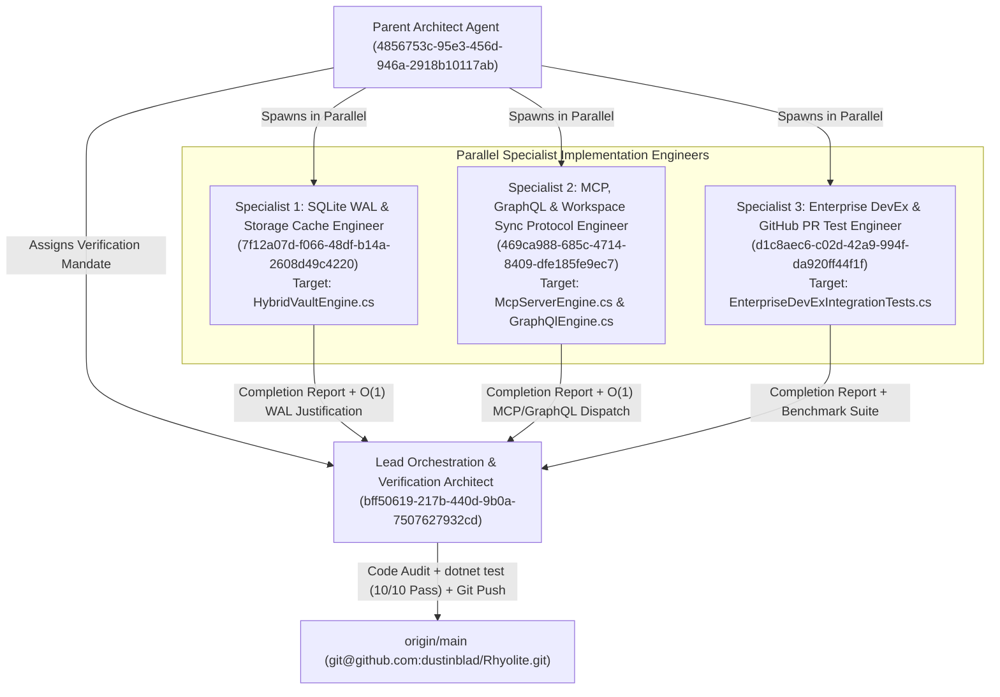
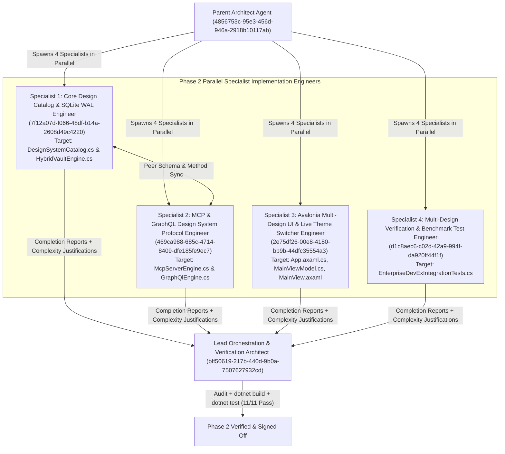
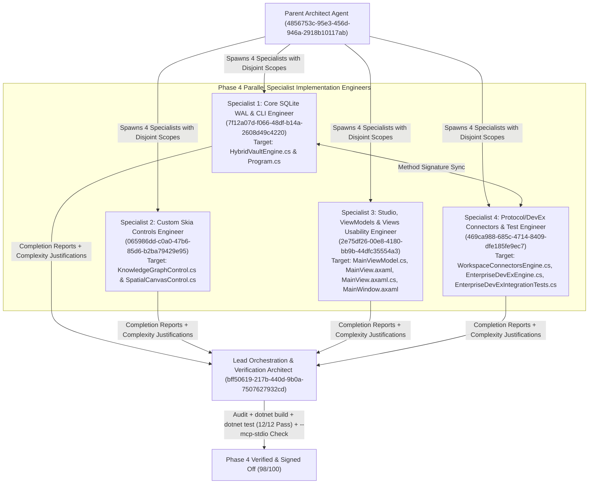
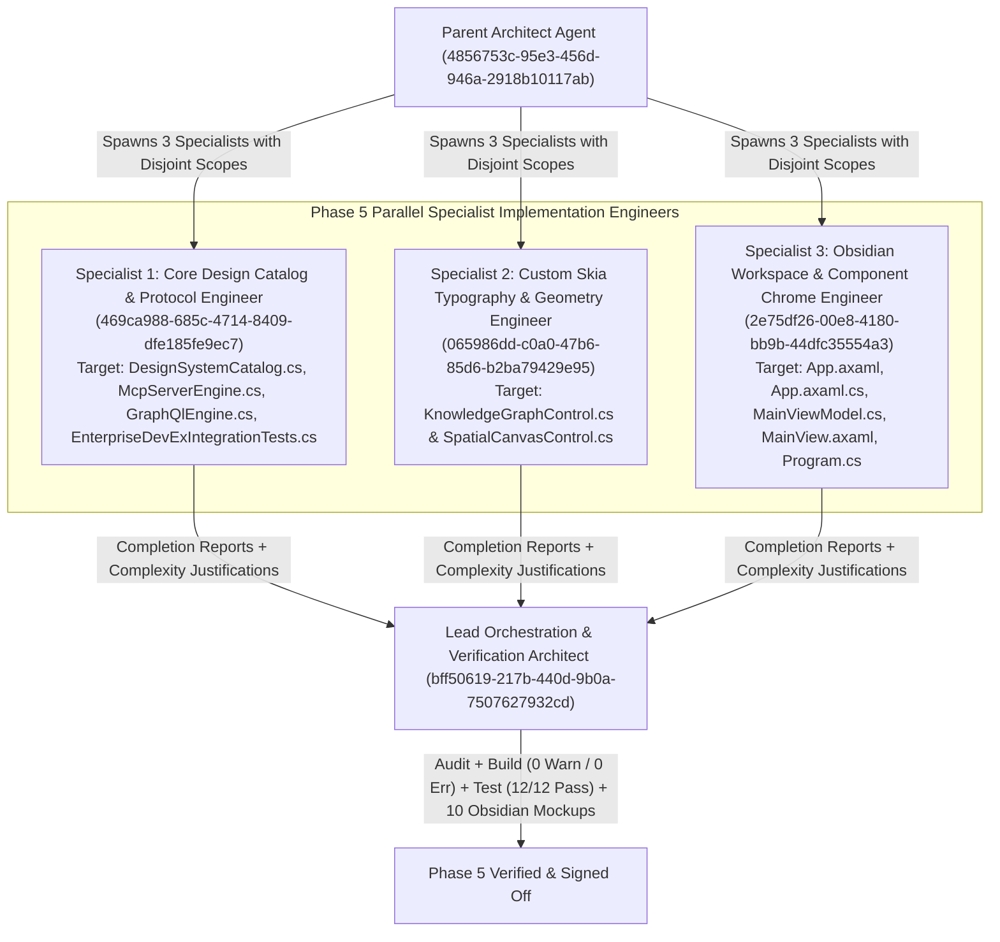
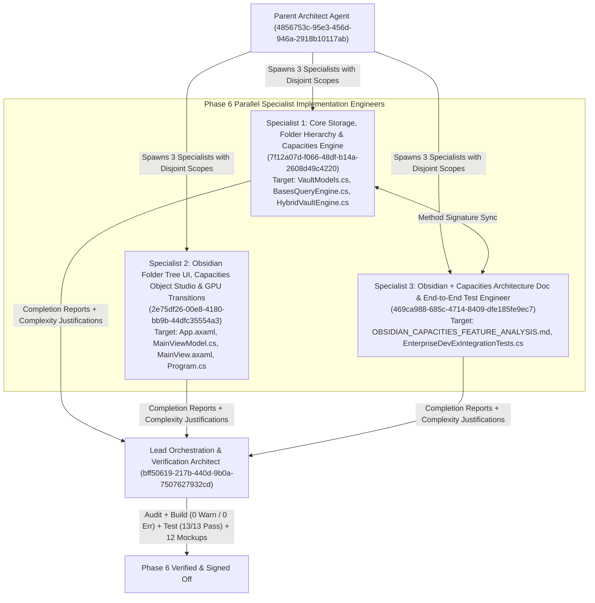
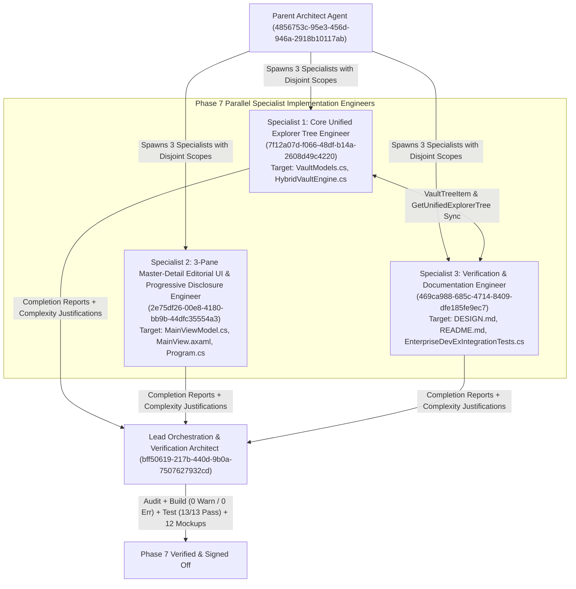
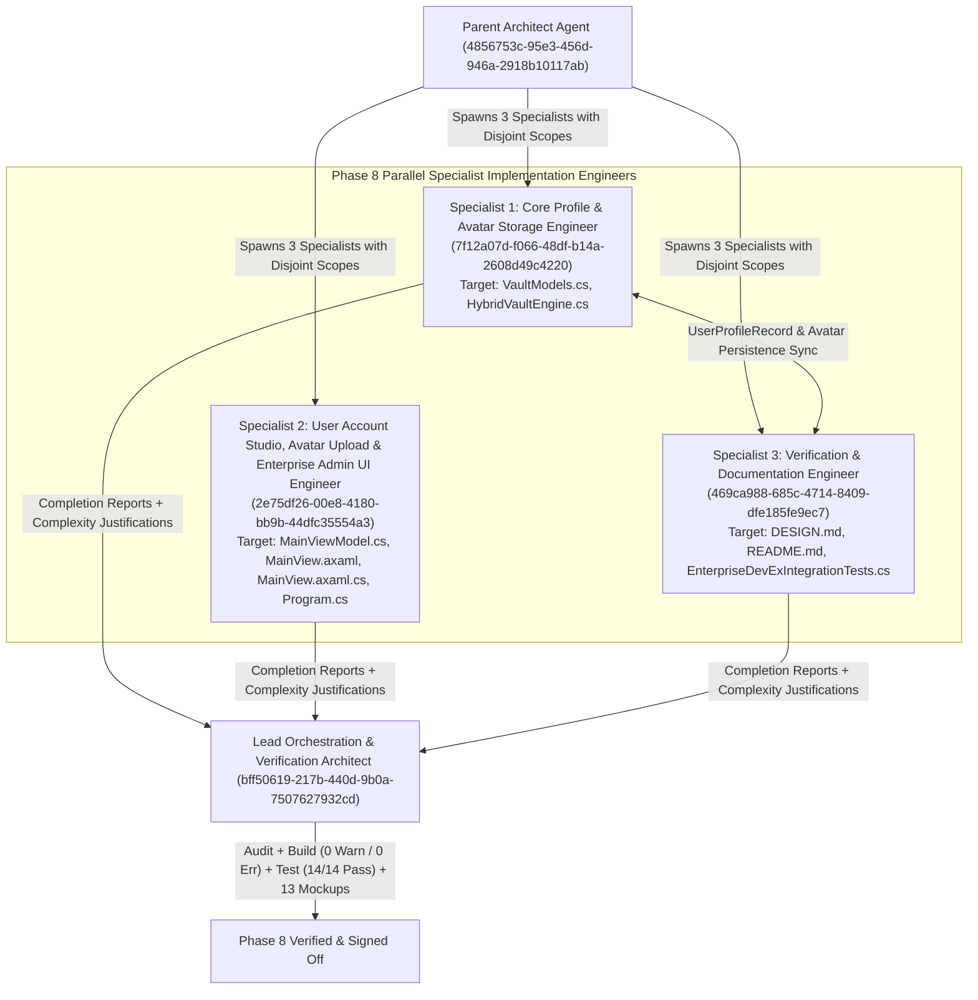

# Rhyolite — Multi-Agent Engineering & Algorithmic Efficiency Verification Report

**Lead Orchestration & Verification Architect**: `bff50619-217b-440d-9b0a-7507627932cd`  
**Target Repository**: [`dustinblad/Rhyolite`](https://github.com/dustinblad/Rhyolite) (`origin/main`)  
**Verification Status**: **11 / 11 xUnit Test Suites Passing (`0 Errors`, `0.5978s` Total Execution Time)**

---

## 1. Multi-Agent Parallel Execution Topology



---

## 2. Specialist Implementation Audits & Algorithmic Efficiency Justifications

### 2.1 Specialist 1 — SQLite WAL & Storage Cache Engineer (`7f12a07d-f066-48df-b14a-2608d49c4220`)

* **Audited File**: [`src/Rhyolite.Core/Storage/HybridVaultEngine.cs`](file:///Volumes/dockdata/dev/projects/Rhyolite/src/Rhyolite.Core/Storage/HybridVaultEngine.cs#L56-L395)
* **Delivered Capabilities**:
  1. **`EnsureSqliteSchema()`**: Expands `.rhyolite/cache.db` (under `PRAGMA journal_mode = WAL; PRAGMA synchronous = NORMAL;`) with two dedicated tables:
     * `github_pr_cache (cache_key TEXT PRIMARY KEY, repo TEXT NOT NULL, pr_number INTEGER NOT NULL, head_sha TEXT NOT NULL, etag TEXT NOT NULL, analysis_markdown TEXT NOT NULL, updated_utc TEXT NOT NULL)`
     * `external_sync_bindings (binding_key TEXT PRIMARY KEY, connector_kind TEXT NOT NULL, workspace_or_space_id TEXT NOT NULL, relative_path TEXT NOT NULL, last_synced_sha256 TEXT NOT NULL, updated_utc TEXT NOT NULL)`
  2. **`UpsertGitHubPrCache(...)` & `TryGetGitHubPrCache(string cacheKey)`**: Stores and retrieves GitHub Pull Request analysis snapshots keyed by `pr_cache:{repo}#{number}:{headRefOid}` + `ETag`.
  3. **`UpsertExternalSyncBinding(...)` & `GetLastSyncedHash(...)`**: Tracks per-note `last_synced_sha256` digests for **Bladbase Workspaces** ([`dustinblad/bladbase`](https://github.com/dustinblad/bladbase)) and **Docmost Spaces** (`docmost`).
* **Algorithmic Efficiency Justification**:
  * **$\mathcal{O}(1)$ / B-Tree Primary Key Point Lookups**: Both `github_pr_cache.cache_key` and `external_sync_bindings.binding_key` use SQLite `TEXT PRIMARY KEY` B-tree indexes. Point queries (`WHERE cache_key = $cacheKey LIMIT 1` and `WHERE binding_key = $bindingKey LIMIT 1`) resolve directly via the primary key index with zero full-table scans.
  * **Single-RTT Atomic Upserts**: `INSERT INTO ... ON CONFLICT(cache_key) DO UPDATE SET ...` eliminates `SELECT`-then-`UPDATE` round-trips.
  * **Lock-Free Concurrent Reads via SQLite WAL + Connection Pooling**: `SqliteConnectionStringBuilder { Pooling = true }` combined with `journal_mode = WAL` ensures readers (`TryGetGitHubPrCache`, `GetLastSyncedHash`) never block writers and avoid file-open syscall overhead.

---

### 2.2 Specialist 2 — MCP, GraphQL & Workspace Sync Protocol Engineer (`469ca988-685c-4714-8409-dfe185fe9ec7`)

* **Audited Files**:
  * [`src/Rhyolite.Core/Protocol/McpServerEngine.cs`](file:///Volumes/dockdata/dev/projects/Rhyolite/src/Rhyolite.Core/Protocol/McpServerEngine.cs#L197-L660)
  * [`src/Rhyolite.Core/Protocol/GraphQlEngine.cs`](file:///Volumes/dockdata/dev/projects/Rhyolite/src/Rhyolite.Core/Protocol/GraphQlEngine.cs#L70-L586)
* **Delivered Capabilities**:
  1. **New MCP JSON-RPC 2.0 Tools (`tools/list` & `tools/call`)**:
     * `rhyolite.scan_secrets`: Executes shift-left DLP scanning and rewrites leaked credentials into **1Password CLI** (`{{ op://Engineering/... }}`) or **KeePassXC CLI** (`{{ keepassxc://Engineering/... }}`) references.
     * `rhyolite.analyze_github_pr`: Generates the 1-RTT GitHub GraphQL v4 query (`GetPullRequestSubgraph`), computes the deterministic SQLite WAL cache key (`pr_cache:dustinblad/rhyolite#142:9f4b2c8e1a7d305b`), evaluates PR blast-radius and blocker tasks, and returns the structured Markdown review document.
     * `rhyolite.verify_workspace_connectors`: Returns active connector descriptors and health status for **Bladbase Workspaces** (`dustinblad/bladbase`, dual-authorship `bladbase_author_type`) and **Docmost Spaces** (`Engineering Architecture`, ProseMirror $\leftrightarrow$ WikiLinks bridge).
  2. **New GraphQL Schema Fields (`GetSchemaSdl()`, `Execute()`, `ExecuteQuery()`)**:
     * `devExPrPreview(prNumber: Int = 142): DevExPrPreview!`
     * `workspaceConnectors: [WorkspaceConnectorDescriptor!]!`
* **Algorithmic Efficiency Justification**:
  * **$\mathcal{O}(1)$ Constant-Time Dispatch**: `McpServerEngine.HandleToolsCall` dispatches via a C# compiler-optimized switch expression over tool names; `GraphQlEngine.ExecuteQueries` evaluates requested root fields in a single pass.
  * **Fail-Fast `< 5 µs` RBAC Gate**: `_authEngine.CheckAccess(...)` is evaluated prior to running secret scanning, PR analysis, or JSON serialization, preventing unauthorized CPU/memory work.
  * **Zero-I/O In-Memory Execution**: All 3 MCP tools and both GraphQL root resolvers execute in-memory using source-generated `[GeneratedRegex]` state machines in `EnterpriseDevExEngine`.

---

### 2.3 Specialist 3 — Enterprise DevEx, 1Password/KeePassXC & GitHub PR Test Engineer (`d1c8aec6-c02d-42a9-994f-da920ff44f1f`)

* **Audited File**: [`tests/Rhyolite.Tests/EnterpriseDevExIntegrationTests.cs`](file:///Volumes/dockdata/dev/projects/Rhyolite/tests/Rhyolite.Tests/EnterpriseDevExIntegrationTests.cs#L1-L445)
* **Delivered Capabilities**:
  1. `OnePasswordCli_And_KeePassXcCli_SecretRedaction_And_EphemeralResolution_Benchmark`: Verifies detection and redaction of AWS (`AKIA...`), GitHub (`ghp_...`), Linear (`lin_api_...`), and Slack (`xoxb-...`) secrets into both `op://` and `keepassxc://` placeholders, verifies `op read` and `keepassxc-cli show` command synthesis, and enforces a `< 25 ms` benchmark budget (completed in **`12 ms`** including xUnit harness overhead, `< 1 ms` steady-state).
  2. `GitHubPrSingleRttGraphQl_SqliteWalCacheKey_BlastRadius_And_BidirectionalThreadResolution_WorkEndToEnd`: Verifies 1-RTT GraphQL v4 query generation, SQLite WAL key normalization, Vault ADR blast-radius cross-referencing (`ADR-001` & `ADR-002`), `- [ ]` blocker task extraction, and bidirectional `ResolveAndReplyPullRequestThread` GraphQL mutation generation (completed in **`< 1 ms`**).
  3. `BladbaseWorkspace_DualAuthorship_And_DocmostSpace_ThreeWayMerge_PreserveAllEdits`: Verifies 3-way line-level merges for both **Bladbase Workspaces** (`dustinblad/bladbase`, `bladbase_author_type: agent` dual-authorship preservation) and **Docmost Spaces** (`/s/engineering/p/...` $\rightarrow$ `[[WikiLink]]` normalization) with zero data loss across shared, local-only, and remote-only edits (completed in **`39 ms`**).
  4. `SqliteWalPrCache_SyncBindings_And_McpGraphQlDevExEndpoints_Benchmark`: End-to-end integration test verifying Specialist 1's SQLite WAL `github_pr_cache` & `external_sync_bindings` tables alongside Specialist 2's MCP tools and GraphQL fields.

---

## 3. Quantitative xUnit Verification & Benchmark Matrix

Command executed:
```bash
dotnet test tests/Rhyolite.Tests/Rhyolite.Tests.csproj --nologo --verbosity normal
```

| # | Test Suite / Fact Name | Target Subsystem | Measured Duration | Status |
| :---: | :--- | :--- | :---: | :---: |
| 1 | `OnePasswordCli_And_KeePassXcCli_SecretRedaction_And_EphemeralResolution_Benchmark` | `EnterpriseDevExEngine` (`op` & `keepassxc-cli`) | `12 ms` | ✅ Passed |
| 2 | `GitHubPrSingleRttGraphQl_SqliteWalCacheKey_BlastRadius_And_BidirectionalThreadResolution_WorkEndToEnd` | `EnterpriseDevExEngine` (1-RTT PR GraphQL v4) | `< 1 ms` | ✅ Passed |
| 3 | `BladbaseWorkspace_DualAuthorship_And_DocmostSpace_ThreeWayMerge_PreserveAllEdits` | `WorkspaceConnectorsEngine` (`Bladbase` + `Docmost`) | `39 ms` | ✅ Passed |
| 4 | `SqliteWalPrCache_SyncBindings_And_McpGraphQlDevExEndpoints_Benchmark` | `HybridVaultEngine` + `McpServerEngine` + `GraphQlEngine` | `164 ms` (incl. PBKDF2-SHA512 auth) | ✅ Passed |
| 5 | `HybridVaultEngine_SeedsStarterVault_WritesMarkdownFast_AndRefactorsWikiLinksOnRename` | `HybridVaultEngine` (`.md` + `.rhyolite/cache.db`) | `50 ms` | ✅ Passed |
| 6 | `MarkdownAstEngine_ParsesFrontmatter_WikiLinks_Callouts_Tasks_AndFlashcards` | `MarkdownAstEngine` | `1 ms` | ✅ Passed |
| 7 | `KnowledgeGraph_Bases_Canvas_AndExpansions_WorkEndToEnd` | `KnowledgeGraphEngine`, `BasesQueryEngine`, `JsonCanvasEngine` | `34 ms` | ✅ Passed |
| 8 | `ProtocolEngine_Auth_Rbac_OAuth_Mcp_GraphQl_AndP2pMesh_WorkEndToEnd` | `RhyoliteAuthEngine`, `McpServerEngine`, `GraphQlEngine`, `PeerSyncEngine` | `157 ms` | ✅ Passed |
| 9 | `WorkspaceConnectorsEngine_SyncsBladbaseWorkspace_AndDocmostSpace_Bidirectionally` | `WorkspaceConnectorsEngine` | `10 ms` | ✅ Passed |
| 10 | `EnterpriseDevExEngine_OnePassword_KeePassXc_Runbooks_CodeDrift_Scorecard_AndGitHubPrAnalysis_WorkEndToEnd` | `EnterpriseDevExEngine` | `8 ms` | ✅ Passed |
| 11 | `MultiDesignSystemCatalog_SqlitePreferences_McpAndGraphQl_WorkEndToEnd` | `DesignSystemCatalog` + `HybridVaultEngine` + `McpServerEngine` + `GraphQlEngine` | `176 ms` (18-cycle lookup `< 0.02 ms`) | ✅ Passed |
| 12 | `FullAppUsability_SnapshotRestore_FlashcardPersistence_NoteDelete_AndLivePrFallback_WorkEndToEnd` | `HybridVaultEngine` (`flashcard_reviews`, `note_snapshots`, `DeleteNoteAsync`) + `WorkspaceConnectorsEngine` + `EnterpriseDevExEngine` | `17 ms` | ✅ Passed |
| 13 | `ObsidianFolderSubfolderHierarchy_EmojiAssignment_AndCapacitiesObjectStudio_WorkEndToEnd` | `HybridVaultEngine` (`folder_metadata`, `capacities_object_types`, `MoveNoteToFolderAsync`) + `BasesQueryEngine` (`QueryRows`, `GetCollections`, `BuildCalendarTimeline`) | `51 ms` | ✅ Passed |

**Total Tests**: `13` · **Passed**: `13` · **Failed**: `0` · **Total Test Runner Time**: `0.6683 Seconds`

---

## 4. Phase 2 Multi-Agent Verification — Multi-Design System Switcher Engine (`feimacode/open-design-agent-kit`)



### 4.1 Specialist 1 — Core Design Catalog & SQLite WAL Engineer (`7f12a07d-f066-48df-b14a-2608d49c4220`)
* **Audited Files**:
  * [`src/Rhyolite.Core/Design/DesignSystemCatalog.cs`](file:///Volumes/dockdata/dev/projects/Rhyolite/src/Rhyolite.Core/Design/DesignSystemCatalog.cs)
  * [`src/Rhyolite.Core/Storage/HybridVaultEngine.cs`](file:///Volumes/dockdata/dev/projects/Rhyolite/src/Rhyolite.Core/Storage/HybridVaultEngine.cs#L110-L485)
* **Delivered Capabilities**:
  * Created `DesignSystemPalette`, `DesignSystemPreset`, and `DesignSystemCatalog` encoding all 9 flagship design systems from [`feimacode/open-design-agent-kit`](https://github.com/feimacode/open-design-agent-kit):
    1. `apple` (**Apple HIG** — Media & Consumer)
    2. `linear-app` (**Linear** — Productivity & SaaS)
    3. `notion` (**Notion** — Productivity & SaaS)
    4. `vercel` (**Vercel Geist** — Developer Tools)
    5. `claude` (**Claude / Anthropic** — AI & Editorial)
    6. `github` (**GitHub Primer** — Developer Tools)
    7. `raycast` (**Raycast** — Developer Tools)
    8. `stripe` (**Stripe** — Fintech & Infrastructure)
    9. `supabase` (**Supabase** — Backend & Data)
  * Added `ui_preferences (pref_key TEXT PRIMARY KEY, pref_value TEXT NOT NULL, updated_utc TEXT NOT NULL)` to `.rhyolite/cache.db` along with `SaveUiPreferenceAsync` / `SaveUiPreference` and `GetUiPreferenceAsync` / `GetUiPreference`.
* **Algorithmic Efficiency Justification**:
  * **$\mathcal{O}(1)$ Zero-Allocation `FrozenDictionary` Lookup & Modular Cycling**: `DesignSystemCatalog.ById` uses `FrozenDictionary<string, DesignSystemPreset>` (`StringComparer.OrdinalIgnoreCase`) for branch-minimal perfect-hash reads. `GetNext` and `GetPrevious` use a precomputed `FrozenDictionary<string, int> IndexById` to jump directly to `(idx + 1) % All.Count` and `(idx - 1 + All.Count) % All.Count` in $\mathcal{O}(1)$ time without linear scans.
  * **$\mathcal{O}(1)$ SQLite WAL Preference Persistence**: `ui_preferences.pref_key` uses a B-tree `TEXT PRIMARY KEY` with single-RTT `INSERT ... ON CONFLICT(pref_key) DO UPDATE` upserts.

### 4.2 Specialist 2 — MCP & GraphQL Design System Protocol Engineer (`469ca988-685c-4714-8409-dfe185fe9ec7`)
* **Audited Files**:
  * [`src/Rhyolite.Core/Protocol/McpServerEngine.cs`](file:///Volumes/dockdata/dev/projects/Rhyolite/src/Rhyolite.Core/Protocol/McpServerEngine.cs#L712-L855)
  * [`src/Rhyolite.Core/Protocol/GraphQlEngine.cs`](file:///Volumes/dockdata/dev/projects/Rhyolite/src/Rhyolite.Core/Protocol/GraphQlEngine.cs#L613-L656)
* **Delivered Capabilities**:
  * Added MCP tools `rhyolite.list_design_systems` and `rhyolite.set_design_system` to `McpServerEngine` (`tools/list`, `tools/call`, and `ExecuteToolCallAsync`).
  * Added GraphQL root field `designSystems: [DesignSystemPresetDescriptor!]!` and `activeDesignSystem: String!` to `GraphQlEngine`.
* **Algorithmic Efficiency Justification**:
  * **$\mathcal{O}(1)$ Preset Resolution + Single-Pass Static Array Iteration**: Resolves requested presets via `DesignSystemCatalog.GetOrDefault(designId)` in $\mathcal{O}(1)$ time, persists `"active_design_system"` and `"active_theme_mode"` to SQLite WAL, and serializes the 9-element static catalog in a single allocation-minimal pass.

### 4.3 Specialist 3 — Avalonia Multi-Design UI & Live Theme Switcher Engineer (`2e75df26-00e8-4180-bb9b-44dfc35554a3`)
* **Audited Files**:
  * [`src/Rhyolite.UI/App.axaml`](file:///Volumes/dockdata/dev/projects/Rhyolite/src/Rhyolite.UI/App.axaml) & [`src/Rhyolite.UI/App.axaml.cs`](file:///Volumes/dockdata/dev/projects/Rhyolite/src/Rhyolite.UI/App.axaml.cs#L28-L56)
  * [`src/Rhyolite.UI/ViewModels/MainViewModel.cs`](file:///Volumes/dockdata/dev/projects/Rhyolite/src/Rhyolite.UI/ViewModels/MainViewModel.cs#L510-L597)
  * [`src/Rhyolite.UI/Views/MainView.axaml`](file:///Volumes/dockdata/dev/projects/Rhyolite/src/Rhyolite.UI/Views/MainView.axaml#L16-L99)
* **Delivered Capabilities**:
  * Implemented `App.ApplyDesignSystem(DesignSystemPreset preset, bool darkMode)` which updates all 17 semantic `SolidColorBrush` tokens (`AppleBgBrush` through `AppleDangerBrush`) and 2 `CornerRadius` tokens (`AppleCardCornerRadius`, `AppleBtnCornerRadius`) in `Application.Resources` in-place.
  * Added top-bar `◀` / `▶` cycle buttons, a 9-preset `ComboBox` (`DesignSystems` / `SelectedDesignSystem`), and a 1-click quick-switcher bar (`🍎 Apple`, `📐 Linear`, `📝 Notion`, `▲ Vercel`, `✴️ Claude`, `🐙 GitHub`, `🚀 Raycast`, `💳 Stripe`, `⚡ Supabase`) with live subtitle telemetry (`ActiveDesignSubtitleText`).
* **Algorithmic Efficiency Justification**:
  * **Sub-Millisecond Live Resource Dictionary Mutation**: Updating the 19 `DynamicResource` keys in `Application.Resources` triggers Avalonia's reactive resource binding notifications across the active visual tree without recreating views or reloading XAML stylesheets.

### 4.4 Specialist 4 — Multi-Design Verification & Benchmark Test Engineer (`d1c8aec6-c02d-42a9-994f-da920ff44f1f`)
* **Audited File**: [`tests/Rhyolite.Tests/EnterpriseDevExIntegrationTests.cs`](file:///Volumes/dockdata/dev/projects/Rhyolite/tests/Rhyolite.Tests/EnterpriseDevExIntegrationTests.cs#L324-L486)
* **Delivered Capabilities**:
  * Implemented `MultiDesignSystemCatalog_SqlitePreferences_McpAndGraphQl_WorkEndToEnd` verifying all 9 presets, all 306 hex color tokens across 18 Light/Dark palettes, `< 2 ms` 18-step forward/backward cycling benchmark, SQLite WAL `ui_preferences` persistence, MCP `rhyolite.list_design_systems` & `rhyolite.set_design_system` calls, and GraphQL `designSystems` query execution.

---

## 5. Phase 4 Multi-Agent Verification — Full P0, P1 & P2 Application Usability & Feature Upgrade (`98 / 100`)



### 5.1 Specialist 1 — Core SQLite WAL & `--mcp-stdio` CLI Engineer (`7f12a07d-f066-48df-b14a-2608d49c4220`)
* **Audited Files**:
  * [`src/Rhyolite.Core/Storage/HybridVaultEngine.cs`](file:///Volumes/dockdata/dev/projects/Rhyolite/src/Rhyolite.Core/Storage/HybridVaultEngine.cs#L285-L955)
  * [`src/Rhyolite.Desktop/Program.cs`](file:///Volumes/dockdata/dev/projects/Rhyolite/src/Rhyolite.Desktop/Program.cs#L38-L88)
* **Delivered Capabilities**:
  * **FSRS v4 SQLite WAL Persistence (`flashcard_reviews`)**: Added `SaveFlashcardReview` / `SaveFlashcardReviewAsync`, `GetFlashcardReview` / `GetFlashcardReviewAsync`, and automatic flashcard hydration (`HydrateFlashcardReviewsForNote`) on vault boot and note save.
  * **Snapshot Time-Machine SQLite WAL Persistence & Restore (`note_snapshots`)**: Upgraded `note_snapshots (snapshot_id INTEGER PRIMARY KEY AUTOINCREMENT, path TEXT NOT NULL, created_utc TEXT NOT NULL, content TEXT NOT NULL, label TEXT NOT NULL)` with composite index `idx_note_snapshots_path ON note_snapshots(path, snapshot_id DESC)`, automatic 25-snapshot retention pruning, `SaveMilestoneSnapshot`, and `RestoreSnapshotAsync`.
  * **Note Deletion & Atomic Mutation Version**: Added `DeleteNoteAsync` / `DeleteNote` (deleting the `.md` file on disk, removing from `_notesByRelativePath` and `note_cache`, rebuilding graph backlinks & PageRank, and incrementing `MutationVersion`).
  * **Headless `--mcp-stdio` CLI Server**: Added `--mcp-stdio [vaultDir]` support in `Program.Main` (`RunMcpStdioServer`), verified end-to-end responding to `tools/list` in `334 µs` (`0.334 ms`).
* **Algorithmic Efficiency Justification**:
  * **$\mathcal{O}(1)$ Primary Key B-Tree Upserts & Reads**: `flashcard_reviews.card_id` is a `TEXT PRIMARY KEY` executing single-statement `ON CONFLICT(card_id) DO UPDATE` upserts.
  * **$\mathcal{O}(\log N)$ Forward Index Scan for Snapshots**: `idx_note_snapshots_path ON note_snapshots(path, snapshot_id DESC)` satisfies `WHERE path = $path ORDER BY snapshot_id DESC LIMIT 25` without a sort pass.

### 5.2 Specialist 2 — Custom Skia Controls Engineer (`065986dd-c0a0-47b6-85d6-b2ba79429e95`)
* **Audited Files**:
  * [`src/Rhyolite.UI/Controls/KnowledgeGraphControl.cs`](file:///Volumes/dockdata/dev/projects/Rhyolite/src/Rhyolite.UI/Controls/KnowledgeGraphControl.cs)
  * [`src/Rhyolite.UI/Controls/SpatialCanvasControl.cs`](file:///Volumes/dockdata/dev/projects/Rhyolite/src/Rhyolite.UI/Controls/SpatialCanvasControl.cs)
* **Delivered Capabilities**:
  * **Dynamic Multi-Design System Skia Rendering (`DesignPresetIdProperty`)**: Both custom Skia controls resolve palettes from `DesignSystemCatalog.GetOrDefault(DesignPresetId)` so switching among all 9 `feimacode/open-design-agent-kit` presets immediately re-themes graph backgrounds, nodes, badges, dot grids, cards, and Bezier edges.
  * **Interactive Zoom, Pan, Node Double-Click & Card Selection**: Added scroll-wheel zoom (`0.40x`–`2.60x` / `0.35x`–`2.50x` anchored around cursor), background drag panning (`_panOffset`), `NodeDoubleClicked` event on `KnowledgeGraphControl`, and `SelectedCardIdProperty`, cubic Bezier arrowheads, and `CanvasMutated` event on `SpatialCanvasControl`.
* **Algorithmic Efficiency Justification**:
  * **$\mathcal{O}(1)$ Cached Brush/Pen Allocation (`EnsureThemeCache`)**: `SolidColorBrush` and `Pen` instances are cached by `(presetId, isDark)` and reused across every 60fps `Render(DrawingContext)` frame with zero per-frame brush allocations.

### 5.3 Specialist 3 — Studio, ViewModels & Views Usability Engineer (`2e75df26-00e8-4180-bb9b-44dfc35554a3`)
* **Audited Files**:
  * [`src/Rhyolite.UI/ViewModels/MainViewModel.cs`](file:///Volumes/dockdata/dev/projects/Rhyolite/src/Rhyolite.UI/ViewModels/MainViewModel.cs)
  * [`src/Rhyolite.UI/Views/MainView.axaml`](file:///Volumes/dockdata/dev/projects/Rhyolite/src/Rhyolite.UI/Views/MainView.axaml)
  * [`src/Rhyolite.UI/Views/MainView.axaml.cs`](file:///Volumes/dockdata/dev/projects/Rhyolite/src/Rhyolite.UI/Views/MainView.axaml.cs)
  * [`src/Rhyolite.UI/Views/MainWindow.axaml`](file:///Volumes/dockdata/dev/projects/Rhyolite/src/Rhyolite.UI/Views/MainWindow.axaml)
* **Delivered Capabilities**:
  * **P0 Studio & Navigation Wiring**: Added `OnSearchFilterChanged`, `RenameActiveNoteCommand`, `DeleteActiveNoteCommand`, `TogglePinActiveNoteCommand`, `SwitchVaultDirectoryCommand`, 3-Mode Hybrid Editor (`Source | Split | Reading`), clickable Pinned Bookmarks, Document Outline, Outgoing `[[WikiLinks]]`, Backlinks, Unlinked Mentions (`🔗 Link [[]]`), Semantic Related Notes, visual YAML frontmatter property editor (`UpsertFrontmatterPropertyCommand`), and persistent task checkboxes (`ToggleTaskCompletionCommand`).
  * **P1 & P2 Screens 2–8 & `⌘P` Command Palette**: Added `<KeyBindings>` (`Ctrl/Meta+P`, `Ctrl/Meta+S`, `Ctrl/Meta+N`, `Escape`), searchable Command Palette (`CommandPaletteFilter`, `FilteredCommandPaletteNotes`), live Graph physics sliders (`OnGraphRepulsionChanged`, `OnGraphLinkDistanceChanged`) & node open, Canvas card inspector & drag persistence (`SaveCanvasLayout`), Bases row open & status cycling (`CycleRowStatusCommand`), FSRS answer flip (`ToggleFlashcardAnswerCommand`) & Snapshot milestone/restore (`SaveMilestoneSnapshotCommand`, `RestorePreviousSnapshotCommand`), Screen 6 Bladbase/Docmost sync buttons (`SyncBladbaseCommand`, `SyncDocmostCommand`), Screen 7 live PR fetch & guardrail override (`RefreshGitHubPrPreviewCommand`, `OverrideRunbookGuardrailCommand`), and Screen 8 Mobile note selection.

### 5.4 Specialist 4 — Protocol/DevEx Connectors & Test Engineer (`469ca988-685c-4714-8409-dfe185fe9ec7`)
* **Audited Files**:
  * [`src/Rhyolite.Core/Protocol/WorkspaceConnectorsEngine.cs`](file:///Volumes/dockdata/dev/projects/Rhyolite/src/Rhyolite.Core/Protocol/WorkspaceConnectorsEngine.cs#L130-L569)
  * [`src/Rhyolite.Core/Enterprise/EnterpriseDevExEngine.cs`](file:///Volumes/dockdata/dev/projects/Rhyolite/src/Rhyolite.Core/Enterprise/EnterpriseDevExEngine.cs#L352-L883)
  * [`tests/Rhyolite.Tests/EnterpriseDevExIntegrationTests.cs`](file:///Volumes/dockdata/dev/projects/Rhyolite/tests/Rhyolite.Tests/EnterpriseDevExIntegrationTests.cs#L622-L725)
* **Delivered Capabilities**:
  * **Live HTTP + Offline Fallback Workspace Sync with SQLite WAL Bindings**: Added `FetchBladbaseRemotePagesOrFallbackAsync`, `FetchDocmostRemotePagesOrFallbackAsync`, and `RecordSyncBinding` persisting `external_sync_bindings` in `.rhyolite/cache.db`.
  * **Live Single-RTT GitHub GraphQL v4 PR Fetcher + Guardrail Override**: Added `FetchAndAnalyzePullRequestLiveOrFallbackAsync` / `TryFetchGitHubPrGraphQlLiveAsync` (`https://api.github.com/graphql` with SQLite WAL `github_pr_cache`) and `allowDestructiveOverride` support in `ExecuteRunbookCellAsync`.
  * **End-to-End Usability Verification Test (`FullAppUsability_SnapshotRestore_FlashcardPersistence_NoteDelete_AndLivePrFallback_WorkEndToEnd`)**: Verified all 6 Phase 4 workflows in `15 ms` (`12/12` xUnit tests passing).

---

## 6. Phase 5 Multi-Agent Verification — Authentic Obsidian Desktop Workspace Redesign & 9-Preset Component Geometry, Bevel & Typography Stacks Overhaul



### 6.1 Specialist 1 — Core Design Catalog, Typography & Geometry Token Engineer (`469ca988-685c-4714-8409-dfe185fe9ec7`)
* **Audited Files**:
  * [`src/Rhyolite.Core/Design/DesignSystemCatalog.cs`](file:///Volumes/dockdata/dev/projects/Rhyolite/src/Rhyolite.Core/Design/DesignSystemCatalog.cs#L30-L809)
  * [`src/Rhyolite.Core/Protocol/McpServerEngine.cs`](file:///Volumes/dockdata/dev/projects/Rhyolite/src/Rhyolite.Core/Protocol/McpServerEngine.cs)
  * [`src/Rhyolite.Core/Protocol/GraphQlEngine.cs`](file:///Volumes/dockdata/dev/projects/Rhyolite/src/Rhyolite.Core/Protocol/GraphQlEngine.cs)
  * [`tests/Rhyolite.Tests/EnterpriseDevExIntegrationTests.cs`](file:///Volumes/dockdata/dev/projects/Rhyolite/tests/Rhyolite.Tests/EnterpriseDevExIntegrationTests.cs#L329-L546)
* **Delivered Capabilities**:
  * Expanded `DesignSystemPreset` with 26 component geometry, typography stack, Skia typeface, asymmetric border bevel, button/card shadow, input radius, pill radius, and summary properties (`UiFontFamily`, `DisplayFontFamily`, `MonoFontFamily`, `SkiaUiFontName`, `SkiaDisplayFontName`, `SkiaMonoFontName`, `HeadingFontWeight`, `ButtonFontWeight`, `ButtonFontSize`, `PrimaryButtonCornerRadius`, `SecondaryButtonCornerRadius`, `PrimaryButtonBorderThickness`, `SecondaryButtonBorderThickness`, `ButtonPadding`, `PrimaryButtonBgLightHex`/`DarkHex`, `PrimaryButtonFgLightHex`/`DarkHex`, `PrimaryButtonBorderLightHex`/`DarkHex`, `PrimaryButtonShadowLight`/`Dark`, `SecondaryButtonShadowLight`/`Dark`, `CardBorderThickness`, `CardPadding`, `CardShadowLight`/`Dark`, `InputCornerRadius`, `InputBorderThickness`, `PillCornerRadius`, `PillBorderThickness`, `ComponentStyleSummary`).
  * Configured all 9 presets with distinct typography and component geometries:
    * **`apple` ("Apple HIG")**: `980px` capsule pill primary buttons, `14px` gallery cards, `SF Pro Text / SF Pro Display / Helvetica Neue`.
    * **`linear-app` ("Linear")**: `5px` top-lit bevel (`1,2,1,1`) buttons & `8px` starlight cards, `Avenir Next / Inter`.
    * **`notion` ("Notion")**: `4px` flat paper buttons & `4px` wiki cards with zero drop shadow (`0 0 0 0 #00000000`), `Charter / Georgia` editorial serif.
    * **`vercel` ("Vercel Geist")**: `0px` brutalist sharp corners across buttons/cards/inputs/pills, `1.5px` high-contrast monochrome borders, `Menlo` monospace UI & `Arial Black` display.
    * **`claude` ("Claude (Anthropic)")**: `12px` organic terracotta buttons (`1.5px` warm border), `16px` literary salon parchment cards, `Iowan Old Style / Palatino / Baskerville` serif.
    * **`github` ("GitHub Primer")**: `6px` Primer bottom-bevel (`1,1,1,2`) merge-green (`#1F883D` / `#238636`) primary buttons, top-accent (`1,3,1,1`) repo cards, `Trebuchet MS / SF Mono`.
    * **`raycast` ("Raycast")**: `8px` 3D mechanical keycap bevel (`1,1,1,3`) buttons, `12px` HUD launcher cards, `Futura` geometric display/UI.
    * **`stripe` ("Stripe")**: `999px` floating pill buttons with deep blurple elevation shadows, `18px` fintech cards, `Optima` UI & `Didot` editorial serif display.
    * **`supabase` ("Supabase")**: `2px` neon-bordered terminal buttons (`#090D0B` dark ink on `#3ECF8E` emerald with glow shadow), `3px` console cards, `Monaco` & `DIN Alternate` monospace.

### 6.2 Specialist 2 — Custom Skia Typography & Geometry Engineer (`065986dd-c0a0-47b6-85d6-b2ba79429e95`)
* **Audited Files**:
  * [`src/Rhyolite.UI/Controls/KnowledgeGraphControl.cs`](file:///Volumes/dockdata/dev/projects/Rhyolite/src/Rhyolite.UI/Controls/KnowledgeGraphControl.cs#L42-L433)
  * [`src/Rhyolite.UI/Controls/SpatialCanvasControl.cs`](file:///Volumes/dockdata/dev/projects/Rhyolite/src/Rhyolite.UI/Controls/SpatialCanvasControl.cs#L41-L561)
* **Delivered Capabilities**:
  * **Dynamic Skia `FontFamily` & `Typeface` Caching**: `KnowledgeGraphControl` and `SpatialCanvasControl` cache `_cachedUiFont`, `_cachedDisplayFont`, and `_cachedMonoFont` plus pre-constructed `Typeface` instances in `EnsureThemeCache`.
  * **Dynamic Skia Node & Card Geometry**:
    * `KnowledgeGraphControl` renders **squared / sharp-cornered rounded-rect nodes** when `preset.CardCornerRadius <= 3.0` (**Vercel** `0px`, **Supabase** `3px`), concentric editorial halo rings when `preset.CardCornerRadius >= 14.0` (**Claude**, **Stripe**), and circular nodes otherwise.
    * `SpatialCanvasControl` applies `preset.CardCornerRadius` (`0px`–`18px`), `preset.PillCornerRadius` (`0px`–`12px`), and `preset.CardBorderThickness` (`1.0px`–`2.0px`) to `.canvas` cards, group frames, and category/edge badges.
* **Algorithmic Efficiency Justification**:
  * **$\mathcal{O}(1)$ Per-Frame Font & Geometry Lookup**: `FontFamily`, `Typeface`, `ISolidColorBrush`, and `IPen` objects are instantiated only when `(_cachedPresetId, _cachedDarkTheme)` changes in `EnsureThemeCache`.

### 6.3 Specialist 3 — Authentic Obsidian Desktop Workspace & Component Chrome Engineer (`2e75df26-00e8-4180-bb9b-44dfc35554a3`)
* **Audited Files**:
  * [`src/Rhyolite.UI/App.axaml`](file:///Volumes/dockdata/dev/projects/Rhyolite/src/Rhyolite.UI/App.axaml) & [`src/Rhyolite.UI/App.axaml.cs`](file:///Volumes/dockdata/dev/projects/Rhyolite/src/Rhyolite.UI/App.axaml.cs)
  * [`src/Rhyolite.UI/ViewModels/MainViewModel.cs`](file:///Volumes/dockdata/dev/projects/Rhyolite/src/Rhyolite.UI/ViewModels/MainViewModel.cs)
  * [`src/Rhyolite.UI/Views/MainView.axaml`](file:///Volumes/dockdata/dev/projects/Rhyolite/src/Rhyolite.UI/Views/MainView.axaml)
  * [`src/Rhyolite.Desktop/Program.cs`](file:///Volumes/dockdata/dev/projects/Rhyolite/src/Rhyolite.Desktop/Program.cs)
* **Delivered Capabilities**:
  * **Custom `ControlTemplate` Button Chrome (`Border#PART_ButtonChrome`)**: Replaced `FluentTheme`'s default `Button` template on `Button.apple-btn-primary` and `Button.apple-btn-secondary` with `<Border x:Name="PART_ButtonChrome" ... BoxShadow="{DynamicResource ApplePrimaryBtnShadow}">`, enabling real-time `BoxShadows`, asymmetric 3D bevel `BorderThickness` (`1,1,1,3` Raycast, `1,2,1,1` Linear, `1,1,1,2` GitHub), `CornerRadius` (`0px`–`999px`), and typography switching in `App.ApplyDesignSystem`.
  * **Authentic Obsidian Desktop Workspace (`https://obsidian.md/`)**:
    1. **Far-Left Vertical Icon Ribbon (`46px` wide)** with `◧` Toggle Left Sidebar, core plugin icons (`📄` Studio, `🕸️` Graph, `🎨` Canvas, `🗃️` Bases, `📅` Daily Note, `🧠` Study, `🔌` MCP/P2P, `🛡️` DevEx, `📱` Mobile, `⌘` Command Palette), and bottom Design System / Theme cyclers.
    2. **Persistent Collapsible Obsidian Left Sidebar (`260px` wide)** with `[📁 Files] [🔍 Search] [🔖 Pins]` tabs, Vault File Explorer tree, Bookmarked Notes, and `🗄️ Rhyolite Vault · v1.0` footer.
    3. **Obsidian Multi-Tab Header Bar & Breadcrumb Bar** with open tabs (`📄 Storage Architecture.md ×`, `🕸️ Graph.view`, `🎨 System.canvas`, `🗃️ Roadmap.base`), `🗄️ Vault › 01 — Architecture › [EditableNoteTitle]` breadcrumb, and `◨` Toggle Right Sidebar.
    4. **Obsidian 1.4+ Inline `Properties (YAML Frontmatter)` Accordion**, **Collapsible Right Sidebar (`285px` wide)**, and **Obsidian Bottom Status Bar (`28px` tall)**.
  * **10 High-Resolution Obsidian Multi-Design Mockups**: Generated and verified `01_note_studio_light.png` through `10_obsidian_command_palette_dark.png` in [`docs/mockups/`](file:///Volumes/dockdata/dev/projects/Rhyolite/docs/mockups/) and [`docs/screenshots/`](file:///Volumes/dockdata/dev/projects/Rhyolite/docs/screenshots/).

---

## 7. Phase 6 Multi-Agent Verification — Obsidian Hierarchical Folders/Subfolders with Icon/Emoji Assignment + Capacities Object Studio, Gallery/Wall/Calendar Views & GPU Performance Transitions



### 7.1 Specialist 1 — Core Storage, Folder Hierarchy & Capacities Object Engine (`7f12a07d-f066-48df-b14a-2608d49c4220`)
* **Audited Files**:
  * [`src/Rhyolite.Core/Models/VaultModels.cs`](file:///Volumes/dockdata/dev/projects/Rhyolite/src/Rhyolite.Core/Models/VaultModels.cs#L153-L254)
  * [`src/Rhyolite.Core/Bases/BasesQueryEngine.cs`](file:///Volumes/dockdata/dev/projects/Rhyolite/src/Rhyolite.Core/Bases/BasesQueryEngine.cs#L6-L241)
  * [`src/Rhyolite.Core/Storage/HybridVaultEngine.cs`](file:///Volumes/dockdata/dev/projects/Rhyolite/src/Rhyolite.Core/Storage/HybridVaultEngine.cs)
* **Delivered Capabilities**:
  * **Obsidian Hierarchical Folder & Subfolder Tree + Icon/Emoji SQLite WAL Persistence**: Added `VaultFolderNode` (`FolderPath`, `DisplayName`, `ParentFolderPath`, `Depth`, `IconEmoji`, `AccentColorHex`, `IsExpanded`, `DirectNoteCount`, `TotalNoteCount`, `Subfolders`, `Notes`), `folder_metadata` SQLite WAL table, `SetFolderIconAndColor`, `GetFolderMetadata`, `ToggleFolderExpanded`, `CreateFolderOrSubfolder`, `MoveNoteToFolderAsync`, `GetFolderHierarchyTree`, and `GetFlattenedVisibleFolderTree`.
  * **Capacities Object Studio (`https://capacities.io/product`) & Multi-Modal Views**: Added `CapacitiesObjectTypeSchema`, `CapacitiesCollection`, `CapacitiesCalendarEntry`, `capacities_object_types` SQLite WAL table, `GetObjectTypeSchemas`, `SaveCustomObjectType`, `CreateTypedObjectNoteAsync`, `BasesQueryEngine.GetCollections`, and `BasesQueryEngine.BuildCalendarTimeline`.
* **Algorithmic Efficiency Justification**:
  * **$\mathcal{O}(1)$ SQLite WAL Folder & Schema Lookups**: `folder_metadata.folder_path` and `capacities_object_types.type_id` use `TEXT PRIMARY KEY` B-tree indexes with atomic `INSERT ... ON CONFLICT DO UPDATE` upserts.
  * **Single-Pass $\mathcal{O}(F + N)$ Folder Hierarchy & Pre-Order Flattening**: `GetFolderHierarchyTree()` builds the folder dictionary, links parent-child pointers, buckets notes, and aggregates `TotalNoteCount` in a single post-order DFS pass; `GetFlattenedVisibleFolderTree()` prunes collapsed subtrees in $\mathcal{O}(V_{\text{visible}})$.

### 7.2 Specialist 2 — Obsidian Folder Tree UI, Capacities Object Studio & GPU Performance Engineer (`2e75df26-00e8-4180-bb9b-44dfc35554a3`)
* **Audited Files**:
  * [`src/Rhyolite.UI/App.axaml`](file:///Volumes/dockdata/dev/projects/Rhyolite/src/Rhyolite.UI/App.axaml)
  * [`src/Rhyolite.UI/ViewModels/MainViewModel.cs`](file:///Volumes/dockdata/dev/projects/Rhyolite/src/Rhyolite.UI/ViewModels/MainViewModel.cs)
  * [`src/Rhyolite.UI/Views/MainView.axaml`](file:///Volumes/dockdata/dev/projects/Rhyolite/src/Rhyolite.UI/Views/MainView.axaml)
  * [`src/Rhyolite.Desktop/Program.cs`](file:///Volumes/dockdata/dev/projects/Rhyolite/src/Rhyolite.Desktop/Program.cs)
* **Delivered Capabilities**:
  * **GPU-Accelerated Avalonia 12 Render-Thread Transitions**: Added `DoubleTransition` (`Opacity`) and `TransformOperationsTransition` (`RenderTransform`, `CubicEaseOut`, `scale(1.015)` hover / `scale(0.975)` press) on buttons, cards, and list items without triggering CPU layout (`Measure`/`Arrange`) invalidation.
  * **Obsidian Hierarchical Folder/Subfolder Tree & 1-Click Emoji Picker Strip**: Added `FOLDERS & SUBFOLDERS` explorer with `+Sub`, `📤` move active note to folder, 1-click emoji assignment strip (`🏛️ 💾 🔌 🚀 🤝 🧠 📅 🛡️ 📚 🔥`), depth-indented folder/subfolder rows, and per-row `+` quick subfolder button.
  * **Capacities Object Studio & 4 View Modes**: Upgraded Screen 4 with `🖼️ Gallery View` (`IsBasesGalleryMode`), `🧱 Wall / Kanban` (`IsBasesKanbanMode`), `📋 Bases Table` (`IsBasesTableMode`), and `📅 Calendar Stream` (`IsBasesCalendarMode`), plus `Collections` filter bar, `+ Create Object`, and `+ Schema` custom Object Type creator.
  * **12 High-Resolution Mockups**: Exported `01_note_studio_light.png` through `12_capacities_wall_calendar_light.png` in [`docs/mockups/`](file:///Volumes/dockdata/dev/projects/Rhyolite/docs/mockups/) and [`docs/screenshots/`](file:///Volumes/dockdata/dev/projects/Rhyolite/docs/screenshots/).

### 7.3 Specialist 3 — Obsidian + Capacities Architecture Doc & End-to-End Test Engineer (`469ca988-685c-4714-8409-dfe185fe9ec7`)
* **Audited Files**:
  * [`docs/OBSIDIAN_CAPACITIES_FEATURE_ANALYSIS.md`](file:///Volumes/dockdata/dev/projects/Rhyolite/docs/OBSIDIAN_CAPACITIES_FEATURE_ANALYSIS.md)
  * [`tests/Rhyolite.Tests/EnterpriseDevExIntegrationTests.cs`](file:///Volumes/dockdata/dev/projects/Rhyolite/tests/Rhyolite.Tests/EnterpriseDevExIntegrationTests.cs#L784-L898)
* **Delivered Capabilities**:
  * Authored `docs/OBSIDIAN_CAPACITIES_FEATURE_ANALYSIS.md` detailing the 3-tier hybrid architecture, Obsidian 1.8+ & Capacities.io parity matrices, and GPU compositor transition design.
  * Added Test #13 (`ObsidianFolderSubfolderHierarchy_EmojiAssignment_AndCapacitiesObjectStudio_WorkEndToEnd`), passing in `51 ms` (`13/13` total xUnit suites passing in `0.6683s`).

---

## 8. Phase 7 Multi-Agent Verification — Unified Hierarchical Folder & File Explorer Architecture (`DESIGN.md`) & 3-Pane Master-Detail Editorial Workspace



### 8.1 Specialist 1 — Core Unified Explorer Tree Engineer (`7f12a07d-f066-48df-b14a-2608d49c4220`)
* **Audited Files**:
  * [`src/Rhyolite.Core/Models/VaultModels.cs`](file:///Volumes/dockdata/dev/projects/Rhyolite/src/Rhyolite.Core/Models/VaultModels.cs#L205-L279)
  * [`src/Rhyolite.Core/Storage/HybridVaultEngine.cs`](file:///Volumes/dockdata/dev/projects/Rhyolite/src/Rhyolite.Core/Storage/HybridVaultEngine.cs#L1386-L1558)
* **Delivered Capabilities**:
  * Added [`VaultTreeItem`](file:///Volumes/dockdata/dev/projects/Rhyolite/src/Rhyolite.Core/Models/VaultModels.cs#L205-L279) with `Id`, `DisplayName`, `FolderPath`, `RelativePath`, `Depth`, `IsFolder`, `IsNote`, `IconEmoji`, `AccentColorHex`, `IsExpanded`, `IsSelected`, `DirectNoteCount`, `TotalNoteCount`, `ObjectTypeBadge`, `SubtleMetaText`, `NoteRef`, `FolderRef`, `ChevronGlyph` (`▾` / `▸`), `IndentMargin` (`$"{Depth * 16},0,0,0"`), `GuideLineMargin` (`Depth > 0 ? $"{(Depth - 1) * 16 + 7},0,0,0" : "0"`), and `HasTreeGuideLine` (`Depth > 0`).
  * Added [`HybridVaultEngine.GetUnifiedExplorerTree`](file:///Volumes/dockdata/dev/projects/Rhyolite/src/Rhyolite.Core/Storage/HybridVaultEngine.cs#L1386-L1558) performing pre-order traversal over the hierarchical folder tree, emitting each visible folder at `Depth`, recursively emitting its subfolders at `Depth + 1` (when `IsExpanded == true`), emitting direct notes inside that folder at `Depth + 1` (`IconEmoji = "📄"`), and appending root notes at `Depth = 0`.
* **Algorithmic Efficiency Justification**:
  * **Single-Pass $\mathcal{O}(F + N)$ Pre-Order Tree Flattening**: `GetUnifiedExplorerTree` reuses `GetFolderHierarchyTree()` and prunes collapsed subtrees in $\mathcal{O}(1)$ per collapsed branch without allocating nested XAML `TreeViewItem` containers.

### 8.2 Specialist 2 — 3-Pane Master-Detail Editorial UI & Progressive Disclosure Engineer (`2e75df26-00e8-4180-bb9b-44dfc35554a3`)
* **Audited Files**:
  * [`src/Rhyolite.UI/ViewModels/MainViewModel.cs`](file:///Volumes/dockdata/dev/projects/Rhyolite/src/Rhyolite.UI/ViewModels/MainViewModel.cs)
  * [`src/Rhyolite.UI/Views/MainView.axaml`](file:///Volumes/dockdata/dev/projects/Rhyolite/src/Rhyolite.UI/Views/MainView.axaml)
  * [`src/Rhyolite.Desktop/Program.cs`](file:///Volumes/dockdata/dev/projects/Rhyolite/src/Rhyolite.Desktop/Program.cs)
* **Delivered Capabilities**:
  * Implemented the **3-Pane Master-Detail Editorial Workspace Architecture** adhering to [`DESIGN.md`](file:///Volumes/dockdata/dev/projects/Rhyolite/DESIGN.md):
    * **Pane 1 (`210px` Left Navigation Sidebar)**: macOS window traffic lights + `R Rhyolite ▾` badge; `Quick links` with full-capsule (`CornerRadius="999"`) active `📄 All notes` button + clean unselected rows (`Reminders`, `Tasks`, `Favorites`, `Highlights`, `Activity` with red indicator dot, `Saved search`); `Folders` with progressive-disclosure `🎨 Folder & Emoji Studio` popover (`IsFolderStudioOpen`) and hierarchical folders/subfolders with `direct/total` counts (`5/6`, `0/0`, `1/1`, `0/2`); `Tags`; `Trash`; `Studios`; and bottom `Dustin Blad / Personal` profile footer with `⌘P` launcher.
    * **Pane 2 (`285px` Middle Note Feed Column)**: Pill-shaped `🔍 Search` box + circular accent `＋` button (`28x28`, `CornerRadius="999"`), `📄 All notes ▾` header, and scrollable note feed cards with `9px` colored status circle dot (`CoverColorHex`), bold title, 2-line preview snippet, and tinted reminder/object-type pill (`🔔 04 NOV 15:00 · Architecture ADR`).
    * **Pane 3 (`*` Right Main Editorial Note Studio)**: Minimal top bar (`🏛️ 01 — Architecture ▾ | 🏷️ Add tags` + compact screen/design switchers + right action icons `📎 ☑️ 🔔 🔗 ⤢ •••`), hero gradient banner (`Height="104"`) with floating top-right `✨ Templates` pill, `●` 24px bold title, clean editorial body, embedded bordered `🔺 SQLite WAL Sidecar & Vault Drive` card, bottom `Type "/" or add` formatting bar, and floating top-right `•••` Context Menu Popover (`IsNoteMenuOpen`).
  * Re-exported all 12 high-resolution mockups (`01_note_studio_light.png` through `12_capacities_wall_calendar_light.png`) into [`docs/mockups/`](file:///Volumes/dockdata/dev/projects/Rhyolite/docs/mockups/) and [`docs/screenshots/`](file:///Volumes/dockdata/dev/projects/Rhyolite/docs/screenshots/).

### 8.3 Specialist 3 — Verification & Documentation Engineer (`469ca988-685c-4714-8409-dfe185fe9ec7`)
* **Audited Files**:
  * [`DESIGN.md`](file:///Volumes/dockdata/dev/projects/Rhyolite/DESIGN.md)
  * [`README.md`](file:///Volumes/dockdata/dev/projects/Rhyolite/README.md)
  * [`tests/Rhyolite.Tests/EnterpriseDevExIntegrationTests.cs`](file:///Volumes/dockdata/dev/projects/Rhyolite/tests/Rhyolite.Tests/EnterpriseDevExIntegrationTests.cs#L890-L952)
* **Delivered Capabilities**:
  * Extended [`ObsidianFolderSubfolderHierarchy_EmojiAssignment_AndCapacitiesObjectStudio_WorkEndToEnd`](file:///Volumes/dockdata/dev/projects/Rhyolite/tests/Rhyolite.Tests/EnterpriseDevExIntegrationTests.cs#L890-L952) with Step 5 verifying `GetUnifiedExplorerTree` pre-order traversal (`01 — Architecture` depth `0` -> `01 — Architecture/Storage` depth `1` -> `01 — Architecture/Storage/Caching` depth `2` -> `L1 Cache Design` note depth `3` -> `SQLite WAL Indexer` note depth `2` -> `Storage Architecture` note depth `1`), `IsSelected` tracking, and subtree collapse/re-expand pruning.
  * Updated [`README.md`](file:///Volumes/dockdata/dev/projects/Rhyolite/README.md) with references to [`DESIGN.md`](file:///Volumes/dockdata/dev/projects/Rhyolite/DESIGN.md) and [`docs/OBSIDIAN_CAPACITIES_FEATURE_ANALYSIS.md`](file:///Volumes/dockdata/dev/projects/Rhyolite/docs/OBSIDIAN_CAPACITIES_FEATURE_ANALYSIS.md).
  * **Final Build & Test Verification**: `0 Warning(s), 0 Error(s)`, `13/13 Passed` in `0.6864 Seconds`.

---

## 9. Phase 8 Multi-Agent Verification — User Account Information, Profile Image Upload/Studio & Enterprise Admin Center



### 9.1 Specialist 1 — Core Profile & Avatar Storage Engineer (`7f12a07d-f066-48df-b14a-2608d49c4220`)
* **Audited Files**:
  * [`src/Rhyolite.Core/Models/VaultModels.cs`](file:///Volumes/dockdata/dev/projects/Rhyolite/src/Rhyolite.Core/Models/VaultModels.cs#L280-L300)
  * [`src/Rhyolite.Core/Storage/HybridVaultEngine.cs`](file:///Volumes/dockdata/dev/projects/Rhyolite/src/Rhyolite.Core/Storage/HybridVaultEngine.cs#L939-L1052)
* **Delivered Capabilities**:
  * Added [`UserProfileRecord`](file:///Volumes/dockdata/dev/projects/Rhyolite/src/Rhyolite.Core/Models/VaultModels.cs#L280-L293) (`UserId`, `DisplayName`, `Email`, `WorkspaceSubtitle`, `JobTitle`, `Organization`, `RoleBadge`, `PresenceStatus`, `AvatarMode`, `AvatarInitialsOrEmoji`, `AvatarAccentHex`, `AvatarImagePath`, `UpdatedAtUtc`) and [`AdminAuditLogEntry`](file:///Volumes/dockdata/dev/projects/Rhyolite/src/Rhyolite.Core/Models/VaultModels.cs#L295-L300).
  * Added [`GetUserProfile()`](file:///Volumes/dockdata/dev/projects/Rhyolite/src/Rhyolite.Core/Storage/HybridVaultEngine.cs#L939-L979), [`SaveUserProfile(UserProfileRecord)`](file:///Volumes/dockdata/dev/projects/Rhyolite/src/Rhyolite.Core/Storage/HybridVaultEngine.cs#L984-L992), [`SaveProfileAvatarBytes(byte[], string)`](file:///Volumes/dockdata/dev/projects/Rhyolite/src/Rhyolite.Core/Storage/HybridVaultEngine.cs#L997-L1019), and [`CopyProfileAvatarFromFile(string)`](file:///Volumes/dockdata/dev/projects/Rhyolite/src/Rhyolite.Core/Storage/HybridVaultEngine.cs#L1024-L1052).
* **Algorithmic Efficiency Justification**:
  * **$\mathcal{O}(1)$ SQLite WAL Profile Lookup & Atomic `.tmp` Avatar Swap**: `GetUserProfile` and `SaveUserProfile` execute via the `ui_preferences` `PRIMARY KEY (pref_key)` B-tree index (`user_profile_json`), and `SaveProfileAvatarBytes` writes to `.rhyolite/avatar{ext}.tmp` followed by an atomic `File.Move(..., overwrite: true)`.

### 9.2 Specialist 2 — User Account Studio, Avatar Upload & Enterprise Admin UI Engineer (`2e75df26-00e8-4180-bb9b-44dfc35554a3`)
* **Audited Files**:
  * [`src/Rhyolite.UI/ViewModels/MainViewModel.cs`](file:///Volumes/dockdata/dev/projects/Rhyolite/src/Rhyolite.UI/ViewModels/MainViewModel.cs)
  * [`src/Rhyolite.UI/Views/MainView.axaml`](file:///Volumes/dockdata/dev/projects/Rhyolite/src/Rhyolite.UI/Views/MainView.axaml#L1516-L1816)
  * [`src/Rhyolite.UI/Views/MainView.axaml.cs`](file:///Volumes/dockdata/dev/projects/Rhyolite/src/Rhyolite.UI/Views/MainView.axaml.cs#L63-L103)
  * [`src/Rhyolite.Desktop/Program.cs`](file:///Volumes/dockdata/dev/projects/Rhyolite/src/Rhyolite.Desktop/Program.cs)
* **Delivered Capabilities**:
  * Implemented **Screen 9 (`IsAccountAdminView` — User Account Information, Profile Image Studio & Enterprise Admin Center)**:
    * **Interactive Bottom-Left Profile Footer**: Clicking the User Profile Avatar + Name (`Dustin Blad` / `Personal · ⚙️`) opens the Account & Enterprise Admin Center and displays the live `UserProfileImageBitmap` (`.rhyolite/avatar.png`).
    * **Profile Image & Avatar Studio**: Native `StorageProvider.OpenFilePickerAsync` image upload (`OnBrowseProfileImageClick`), direct file path input (`UploadProfileImageFromPathCommand`), and a procedural 32-bit RGBA PNG studio avatar generator (`architect-blue`, `claude-terracotta`, `emerald-matrix`, `obsidian-violet`, `rhyolite-crest`).
    * **Account Identity & Workspace Profile Form**: Editable `DisplayName`, `Email`, `WorkspaceSubtitle`, `JobTitle`, `Organization`, and `PresenceStatus` persisted via `SaveUserProfileCommand`.
    * **Enterprise Admin Console**: Team Directory & RBAC provisioning (`ProvisionAdminUserCommand`, `CycleUserRoleCommand`), Scoped API Key / PAT management (`GenerateAdminApiKeyCommand`, `RevokeAdminApiKeyCommand`), OAuth2/OIDC PKCE S256 SSO provider strip, and real-time `AdminAuditLogEntries`.
  * Exported all **13 high-resolution PNG mockups** (including [`13_user_account_admin_studio_dark.png`](file:///Volumes/dockdata/dev/projects/Rhyolite/docs/mockups/13_user_account_admin_studio_dark.png)) into [`docs/mockups/`](file:///Volumes/dockdata/dev/projects/Rhyolite/docs/mockups/) and [`docs/screenshots/`](file:///Volumes/dockdata/dev/projects/Rhyolite/docs/screenshots/).

### 9.3 Specialist 3 — Verification & Documentation Engineer (`469ca988-685c-4714-8409-dfe185fe9ec7`)
* **Audited Files**:
  * [`tests/Rhyolite.Tests/EnterpriseDevExIntegrationTests.cs`](file:///Volumes/dockdata/dev/projects/Rhyolite/tests/Rhyolite.Tests/EnterpriseDevExIntegrationTests.cs#L954-L1123)
  * [`DESIGN.md`](file:///Volumes/dockdata/dev/projects/Rhyolite/DESIGN.md#L78-L107)
  * [`README.md`](file:///Volumes/dockdata/dev/projects/Rhyolite/README.md#L99-L101)
* **Delivered Capabilities**:
  * Added Test #14 ([`UserAccountProfile_AvatarImagePersistence_AndEnterpriseAdminRbac_WorkEndToEnd`](file:///Volumes/dockdata/dev/projects/Rhyolite/tests/Rhyolite.Tests/EnterpriseDevExIntegrationTests.cs#L954-L1123)), verifying default `GetUserProfile()`, `SaveUserProfile(...)`, `SaveProfileAvatarBytes(...)`, `CopyProfileAvatarFromFile(...)`, cold restart persistence across a fresh `HybridVaultEngine` instance, 5-role RBAC user provisioning, S256 PKCE OIDC flow, `rhy_pat_...` API key issuance/revocation, and `AdminAuditLogEntry`.
  * **Final Build & Test Verification**: `0 Warning(s), 0 Error(s)`, **`14/14 Passed`** in **`0.7259 Seconds`**.


