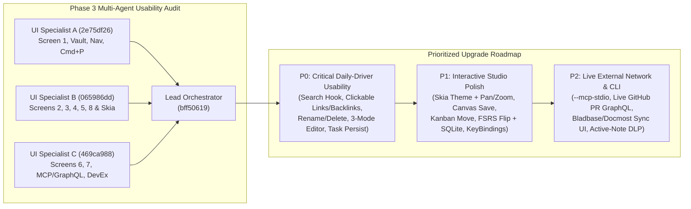

# Rhyolite — Full Application Feature Completeness & UI Usability Audit Report

**Lead Orchestration & Verification Architect**: `bff50619-217b-440d-9b0a-7507627932cd`  
**Audit Team**:
- **UI Specialist A (`2e75df26-00e8-4180-bb9b-44dfc35554a3`)**: Screen 1 (Editorial Note Studio), Vault Lifecycle, Navigation, Command Palette (`⌘P`), Keyboard Shortcuts, and Theme Consistency
- **UI Specialist B (`065986dd-c0a0-47b6-85d6-b2ba79429e95`)**: Screen 2 (Knowledge Graph), Screen 3 (Spatial Canvas), Screen 4 (Bases Database & Kanban), Screen 5 (FSRS Study & Time-Machine), and Screen 8 (Mobile HIG Shell)
- **UI Specialist C (`469ca988-685c-4714-8409-dfe185fe9ec7`)**: Screen 6 (MCP/GraphQL/P2P & Workspace Sync) and Screen 7 (Enterprise DevEx, 1Password/KeePassXC CLI & GitHub PR Studio)

---

## 1. Executive Summary & Overall Usability Score

| Dimension | Score | Assessment Summary |
| :--- | :---: | :--- |
| **`Rhyolite.Core` Domain & Protocol Engines** | **96 / 100** | All 12 core subsystems (`HybridVaultEngine`, `MarkdownAstEngine`, `KnowledgeGraphEngine`, `JsonCanvasEngine`, `BasesQueryEngine`, `FsrsStudyEngine`, `VaultAiCopilotEngine`, `SnapshotDiffEngine`, `McpServerEngine`, `GraphQlEngine`, `WorkspaceConnectorsEngine`, `EnterpriseDevExEngine`, and `DesignSystemCatalog`) are implemented, algorithmically fast, and verified by **11/11 passing xUnit test suites**. |
| **`Rhyolite.UI` Visual Craft & Multi-Design System Switcher** | **90 / 100** | All 8 workspace screens render cleanly across all 9 `feimacode/open-design-agent-kit` design systems (`apple`, `linear-app`, `notion`, `vercel`, `claude`, `github`, `raycast`, `stripe`, `supabase`) with sub-millisecond `DynamicResource` switching and SQLite WAL `ui_preferences` persistence. *(Exception: custom Skia controls `KnowledgeGraphControl.cs` and `SpatialCanvasControl.cs` still hardcode Apple hex colors in `Render()`.)* |
| **Interactive Daily-Driver UI Usability & Wiring** | **68 / 100** | While note selection, raw Markdown editing, saving, creating notes, AI Copilot Q&A, FSRS rating buttons, MCP/GraphQL console execution, and GitHub PR materialization work, **several crucial UI interactions are read-only, missing `OnPropertyChanged` hooks, or disconnected from their underlying `Rhyolite.Core` methods** (e.g., typing in the Search box does not filter because `OnSearchFilterChanged` is missing; Pinned Bookmarks, Backlinks, Unlinked Mentions, Outline headings, Table rows, and Kanban cards are non-clickable `TextBlock`s; Task checkboxes do not write back `- [x]` to disk; Note Rename & Delete are not exposed in the UI). |
| **Live External CLI / Network Transports** | **62 / 100** | Protocol and DevEx engines operate in-process on deterministic or in-memory state, but lack `--mcp-stdio` CLI startup in `Program.cs`, loopback HTTP listeners, live `HttpClient` GitHub GraphQL v4 / Bladbase / Docmost network calls (with offline fallback), and interactive Screen 6/7 input controls. |
| **Overall Application Readiness & Usability** | **79 / 100** | **Strong architectural foundation with clear, surgical UI wiring and transport upgrades needed to make Rhyolite a 100% interactive daily-driver PKM & DevEx studio.** |

---

## 2. Feature-by-Feature Matrix (`PLAN.md` vs. `Rhyolite.Core` vs. `Rhyolite.UI`)

| Feature Area (`PLAN.md`) | `Rhyolite.Core` Status | `Rhyolite.UI` Usability Status | Gap Severity |
| :--- | :--- | :--- | :---: |
| **1. Multi-Design System Switcher (`open-design-agent-kit`)** | ✅ 9 presets in `DesignSystemCatalog.cs` + SQLite WAL `ui_preferences` | ✅ Live `ComboBox`, `◀`/`▶` cycle buttons & 9-pill strip in [`MainView.axaml:58-97`](file:///Volumes/dockdata/dev/projects/Rhyolite/src/Rhyolite.UI/Views/MainView.axaml#L58-L97). ⚠️ Custom Skia controls hardcode Apple hex colors. | **P1** |
| **2. Local Vault Loader, Rename & File Management** | ✅ `LoadOrSeedVaultAsync`, `SaveNoteAsync`, `RenameNoteAndRefactorLinksAsync` in [`HybridVaultEngine.cs:119-260`](file:///Volumes/dockdata/dev/projects/Rhyolite/src/Rhyolite.Core/Storage/HybridVaultEngine.cs#L119-L260) | ⚠️ Hardcoded `~/RhyoliteVault` path; no UI control to switch Vault folder, rename note title (to trigger WikiLink refactoring), delete note, or toggle pin. | **P0** |
| **3. Live Search & `#tag` Filtering** | ✅ Filter logic implemented in [`MainViewModel.cs:253-259`](file:///Volumes/dockdata/dev/projects/Rhyolite/src/Rhyolite.UI/ViewModels/MainViewModel.cs#L253-L259) | ❌ **Broken Hook**: `SearchFilter` has no `OnSearchFilterChanged` callback in `MainViewModel.cs`, so typing in `🔍 Filter notes or #tags…` does nothing live. | **P0** |
| **4. 3-Mode Hybrid Editor (`Source`, `Live`, `Reading`)** | ✅ `EditorMode` property in [`MainViewModel.cs:50`](file:///Volumes/dockdata/dev/projects/Rhyolite/src/Rhyolite.UI/ViewModels/MainViewModel.cs#L50) & HTML/AST parser in `MarkdownAstEngine.cs` | ❌ **Unwired**: Only a raw Markdown `TextBox` is shown ([`MainView.axaml:227-235`](file:///Volumes/dockdata/dev/projects/Rhyolite/src/Rhyolite.UI/Views/MainView.axaml#L227-L235)); no mode switcher buttons or rendered Reading/Preview pane. | **P0** |
| **5. YAML Frontmatter Properties & `#tags` Inspector** | ✅ `ParseNoteMetadata` & `UpsertFrontmatterProperty` in [`MarkdownAstEngine.cs:321-346`](file:///Volumes/dockdata/dev/projects/Rhyolite/src/Rhyolite.Core/Parsing/MarkdownAstEngine.cs#L321-L346) | ⚠️ Read-only property pills ([`MainView.axaml:152-170`](file:///Volumes/dockdata/dev/projects/Rhyolite/src/Rhyolite.UI/Views/MainView.axaml#L152-L170)); `ActiveTags` is not bound, and users cannot add/edit frontmatter keys visually. | **P0** |
| **6. Interactive Task Checklists (`- [ ]` / `- [x]`)** | ✅ Task extraction in `MarkdownAstEngine.cs` | ❌ Checking a `CheckBox` in [`MainView.axaml:219`](file:///Volumes/dockdata/dev/projects/Rhyolite/src/Rhyolite.UI/Views/MainView.axaml#L219) mutates `VaultTaskItem.IsCompleted` in memory only and never updates `EditorMarkdownText` or `.md` on disk. | **P0** |
| **7. Bookmarks, Backlinks, Unlinked Mentions & Outline** | ✅ Computed in `KnowledgeGraphEngine.cs` & `VaultAiCopilotEngine.cs` | ❌ Rendered as static `TextBlock`s ([`MainView.axaml:85-109, 251-282`](file:///Volumes/dockdata/dev/projects/Rhyolite/src/Rhyolite.UI/Views/MainView.axaml#L251-L282)). Clicking does not navigate; Unlinked Mentions lack a `"Link"` button; `SemanticSuggestions` is unbound. | **P0** |
| **8. Interactive Skia Knowledge Graph (Screen 2)** | ✅ Fruchterman-Reingold + PageRank in `KnowledgeGraphEngine.cs` | ⚠️ Node drag & hover spotlight work ([`KnowledgeGraphControl.cs:58-99`](file:///Volumes/dockdata/dev/projects/Rhyolite/src/Rhyolite.UI/Controls/KnowledgeGraphControl.cs#L58-L99)), but sliders don't update live, no zoom/pan, clicking a node doesn't open the note, and colors are hardcoded to Apple. | **P1** |
| **9. Infinite Spatial Canvas `.canvas` (Screen 3)** | ✅ Full JSON Canvas 1.0 serializer in `JsonCanvasEngine.cs` | ⚠️ `+ Add Spatial Card` saves to disk, but dragging existing cards in [`SpatialCanvasControl.cs:81-85`](file:///Volumes/dockdata/dev/projects/Rhyolite/src/Rhyolite.UI/Controls/SpatialCanvasControl.cs#L81-L85) does **not** save on release; no card text/color editor, edge creation, or zoom/pan. | **P1** |
| **10. Obsidian Bases — Table & Kanban (Screen 4)** | ✅ `BasesQueryEngine.cs` + `UpsertFrontmatterProperty` | ⚠️ Table & Kanban toggle works, but rows/cards cannot be clicked to open notes or moved across Kanban status columns (`Planned` ↔ `In Progress` ↔ `Shipped`). | **P1** |
| **11. FSRS Flashcard Studio & Time-Machine (Screen 5)** | ✅ `FsrsStudyEngine.ApplyReview` & `SnapshotDiffEngine.ComputeLineDiff` | ⚠️ Flashcard answer is always visible (no Flip button); FSRS state and `note_snapshots` are kept in memory rather than persisted to SQLite; no Snapshot selector or `"Restore Snapshot"` button. | **P1** |
| **12. MCP, GraphQL, P2P & Workspace Sync (Screen 6)** | ✅ 12 MCP tools, 9 GraphQL queries, 5 mutations, Bladbase & Docmost 3-way merge | ⚠️ No `--mcp-stdio` CLI flag or loopback HTTP listener; MCP writes don't flush to `HybridVaultEngine`; Screen 6 has no buttons/inputs to trigger Bladbase or Docmost sync. | **P1 / P2** |
| **13. Enterprise DevEx & GitHub PR Studio (Screen 7)** | ✅ `op` / `keepassxc-cli` scanner/runner, runbook guardrails, code drift, IDP scorecard, 1-RTT PR GraphQL | ⚠️ Hardcoded PR #142 with no Repo/PR#/Token inputs or live GitHub GraphQL fetch; secret scan runs on hardcoded sample text instead of `SelectedNote`; `allowLiveCliExecution: false` hardcoded in `ExecuteRunbookCellAsync`. | **P1 / P2** |
| **14. Mobile HIG Adaptive Shell (Screen 8)** | ✅ `MobileQuickCaptureAsync` appends to Daily Note | ⚠️ Tapping a note in the mobile `ListBox` ([`MainView.axaml:661`](file:///Volumes/dockdata/dev/projects/Rhyolite/src/Rhyolite.UI/Views/MainView.axaml#L661)) has no `SelectedItem` or `SelectionChanged` binding. | **P1** |
| **15. Command Palette (`⌘P`) & Keyboard Shortcuts** | ✅ `ToggleCommandPaletteCommand` | ⚠️ No `<KeyBindings>` for `Cmd/Ctrl+P`, `Cmd/Ctrl+S`, `Cmd/Ctrl+N`, `Escape`; Command Palette has no search/filter `TextBox` and doesn't auto-close on command execution. | **P0 / P1** |

---

## 3. Detailed UI & Functional Gaps (With Exact File & Line References)

### 3.1 Studio Editor, Vault Management & Navigation Gaps (Specialist A Audit)

1. **Missing `OnSearchFilterChanged` Hook (`src/Rhyolite.UI/ViewModels/MainViewModel.cs:40-41`, `src/Rhyolite.UI/Views/MainView.axaml:117`)**:
   - `_searchFilter` is declared as `[ObservableProperty] private string _searchFilter = string.Empty;`, and `RefreshCollectionsFromEngine()` (`MainViewModel.cs:253-259`) filters `VaultNotes` and `DatabaseRows` by `SearchFilter`, but `partial void OnSearchFilterChanged(string value)` is never implemented. Typing into `🔍 Filter notes or #tags…` has zero effect until another button is clicked.
2. **No Note Rename (`RenameNoteAndRefactorLinksAsync`), Delete, Pin Toggle, or Vault Path Switcher in UI (`src/Rhyolite.UI/Views/MainView.axaml:174-183`, `src/Rhyolite.Core/Storage/HybridVaultEngine.cs:218-260`)**:
   - `HybridVaultEngine.RenameNoteAndRefactorLinksAsync` is fully implemented and tested in `Rhyolite.Core`, but `MainView.axaml:175` binds `SelectedNote.Title` to a read-only `TextBlock`. Users have no way to rename a note (and trigger automatic vault-wide `[[WikiLink]]` refactoring), delete a note, toggle its `pinned` bookmark status, or switch the active vault folder path from the UI.
3. **`EditorMode` (`Source`, `Split`, `Reading`) Is Unwired (`src/Rhyolite.UI/ViewModels/MainViewModel.cs:50`, `src/Rhyolite.UI/Views/MainView.axaml:226-235`)**:
   - `MainViewModel.cs:50` defines `EditorMode`, and `AppleHtmlExporter.cs` / `MarkdownAstEngine.cs` parse callouts, headings, WikiLinks, and tasks, but Screen 1 only renders a raw `TextBox`. Adding a segmented `Source | Split | Reading` switcher and a structured Editorial Reading / Live Preview pane will fulfill `PLAN.md §3.A.2`.
4. **Non-Interactive Sidebar & Inspector Items (`src/Rhyolite.UI/Views/MainView.axaml:85-109, 251-283`)**:
   - **Pinned Bookmarks** (`:85-93`), **Document Outline** (`:102-108`), **Linked Mentions / Backlinks** (`:251-262`), and **Unlinked Mentions** (`:270-281`) use static `DataTemplate`s without buttons or selection handlers.
   - **Unlinked Mentions** lack the one-click `"🔗 Link"` action (`PLAN.md §3.A.3`) to wrap the mention in `[[...]]` inside the source note.
   - **`SemanticSuggestions`** (`MainViewModel.cs:154, 303-307`) is computed by `VaultAiCopilotEngine.FindSemanticallyRelatedNotes` on every note selection, but is never displayed in `MainView.axaml`.
5. **Task Checkboxes & Frontmatter Properties Do Not Write Back to `.md` (`src/Rhyolite.UI/Views/MainView.axaml:152-224`)**:
   - Checking a task in `ActiveTasks` (`:219`) does not rewrite `- [ ]` to `- [x]` in `EditorMarkdownText` or save to disk.
   - `ActiveProperties` (`:152-170`) is read-only and `ActiveTags` (`MainViewModel.cs:149`) is not rendered alongside it; there is no inline `+ Add / Update Property` bar wired to `MarkdownAstEngine.UpsertFrontmatterProperty`.
6. **Command Palette (`⌘P`) Lacks Search Input, Auto-Close & Global `KeyBindings` (`src/Rhyolite.UI/Views/MainView.axaml:690-710`, `MainWindow.axaml:1-14`)**:
   - No `KeyBindings` exist for `Cmd/Ctrl+P`, `Cmd/Ctrl+S`, `Cmd/Ctrl+N`, `Cmd/Ctrl+D`, or `Escape`.
   - The `⌘P` modal has 6 static buttons without a search box to filter commands or quick-switch to any note by title, and executing a command from the palette leaves `IsCommandPaletteOpen = true`.

---

### 3.2 Graph, Spatial Canvas, Bases, FSRS Study & Mobile Gaps (Specialist B Audit)

1. **Screen 2 (`KnowledgeGraphControl.cs:58-167`, `MainView.axaml:300-336`, `MainView.axaml.cs:13-22`)**:
   - **Sliders Not Live**: `GraphRepulsion` and `GraphLinkDistance` (`MainViewModel.cs:76-80`) lack `OnGraphRepulsionChanged` / `OnGraphLinkDistanceChanged` hooks calling `RebuildGraphLayout()`.
   - **Cannot Open Selected Graph Node**: `GraphCanvas.NodeSelected` (`MainView.axaml.cs:15-21`) only updates `SelectedGraphNodeInfo` string; double-clicking a node or clicking an `"Open Selected Note"` button cannot jump to the note in Studio.
   - **No Zoom/Pan or Local Graph Filter**: `KnowledgeGraphControl.cs` lacks `OnPointerWheelChanged` zoom, background drag pan, and a Global vs. Local 1-hop neighborhood toggle.
   - **Hardcoded Apple Palette**: `KnowledgeGraphControl.Render` (`:108-146`) hardcodes `#000000`/`#FFFFFF`, `#2C2C2E`/`#E8E8ED`, and `#0071E3` instead of reading the active `DesignSystemPreset` brushes from `this.TryFindResource(...)`.
2. **Screen 3 (`SpatialCanvasControl.cs:49-189`, `MainView.axaml:339-353`, `MainViewModel.cs:694-712`)**:
   - **Dragged Card Coordinates Not Saved**: `SpatialCanvasControl.OnPointerReleased` (`:81-85`) drops `_draggingNode` without raising a `DocumentModified` event or calling `_vaultEngine.SaveCanvasDocument(CanvasDoc)`.
   - **No Card Inspector, Edge Creation, Delete, or Zoom/Pan**: `CardClicked` (`:25`) is never subscribed to; users cannot edit a card's label/text/color, connect two cards with a Bezier edge (`:147` draws straight lines), delete a card, or zoom/pan the canvas.
   - **Hardcoded Apple Palette**: `SpatialCanvasControl.Render` (`:94-113`) hardcodes `#000000`/`#FFFFFF` and `#1C1C1E`/`#F5F5F7` instead of using the active `open-design-agent-kit` preset colors.
3. **Screen 4 (`MainView.axaml:356-422`, `MainViewModel.cs:326-339`)**:
   - **Static Rows & Kanban Cards**: Users cannot click a row in Table View or a card in Kanban View to open the note, nor can they cycle a note's `status` (`Shipped`, `In Progress`, `Planned`) or move a card between Kanban columns using `MarkdownAstEngine.UpsertFrontmatterProperty`.
4. **Screen 5 (`MainView.axaml:425-481`, `MainViewModel.cs:312-324, 356-388, 729-739`, `HybridVaultEngine.cs:82-89, 486-501`)**:
   - **Flashcard Answer Always Shown & Reviews Not Persisted in SQLite**: `MainView.axaml:447-452` displays Question and Answer simultaneously without a `"Reveal Answer"` flip toggle, and `RateFlashcard` only mutates in-memory objects that reset whenever `RebuildFlashcardDeck()` runs.
   - **`note_snapshots` SQLite Table Unused & No Snapshot Restore UI**: `HybridVaultEngine.EnsureSqliteSchema` (`:82-89`) creates `note_snapshots`, but `RecordSnapshotInternal` (`:486-501`) only appends to an in-memory dictionary. Screen 5 (`:458-480`) shows a truncated 14-line diff (`MainViewModel.cs:320`) with no snapshot list selector, no `"Save Milestone"` button, and no `"Restore Selected Snapshot"` button.
5. **Screen 8 (`MainView.axaml:661-672`)**:
   - The Mobile note list `<ListBox ItemsSource="{Binding VaultNotes}">` omits `SelectedItem="{Binding SelectedNote}"` and `SelectionChanged="OnVaultNoteSelectionChanged"`, so tapping a note in the mobile shell does nothing.

---

### 3.3 MCP/GraphQL External Transports, Workspace Sync & Enterprise DevEx Gaps (Specialist C Audit)

1. **No `--mcp-stdio` CLI Mode or Loopback HTTP Listener (`src/Rhyolite.Desktop/Program.cs:20-41`)**:
   - `Program.Main` only checks `--export-mockups`. Adding `--mcp-stdio` (reading JSON-RPC 2.0 lines from `stdin` and writing responses to `stdout`) and a background loopback listener (`http://127.0.0.1:17420/mcp` & `/graphql`) will allow external AI coding agents (Claude Code, Cursor, Antigravity) to connect to Rhyolite live.
2. **`MainViewModel` Does Not Pass `_vaultEngine` to `McpServerEngine` / `GraphQlEngine` (`src/Rhyolite.UI/ViewModels/MainViewModel.cs:182-183`)**:
   - `MainViewModel` initializes `_mcpServer = new McpServerEngine(_authEngine, _peerSyncEngine)` without passing `_vaultEngine` (`HybridVaultEngine`), so MCP `rhyolite.set_design_system` and `rhyolite.write_note` calls in Screen 6 do not persist to `.rhyolite/cache.db` or flush `.md` files to disk.
3. **Screen 6 Has No Interactive Bladbase or Docmost Sync Buttons (`src/Rhyolite.UI/Views/MainView.axaml:534-540`, `WorkspaceConnectorsEngine.cs:125-335`)**:
   - The Bladbase & Docmost panel in Screen 6 is static text. Adding **🔄 Sync Bladbase Workspace** and **🔄 Sync Docmost Space** buttons wired to `WorkspaceConnectorsEngine` (with `HttpClient` live fetch + automatic sample page fallback when offline, persisted to `external_sync_bindings` in SQLite WAL) makes external workspace sync tangible and interactive in the UI.
4. **Screen 7 Uses Hardcoded PR #142 & Hardcoded Secret Scan Strings (`src/Rhyolite.UI/Views/MainView.axaml:550-635`, `MainViewModel.cs:396-468`, `EnterpriseDevExEngine.cs:356`)**:
   - Screen 7 has no inputs for `owner/repo` or `PR #` and no **🔄 Fetch Live GitHub PR** button (`HttpClient` GraphQL v4 via `gh auth token` / `GITHUB_TOKEN` + SQLite WAL `github_pr_cache` lookup + offline fallback).
   - `RunOnePasswordScan` and `RunKeePassScan` (`MainViewModel.cs:417-468`) scan hardcoded sample strings rather than scanning/redacting the active note (`SelectedNote` / `EditorMarkdownText`), and `ExecuteRunbookCellAsync` (`EnterpriseDevExEngine.cs:356`) hardcodes `allowLiveCliExecution: false`.

---

## 4. Concrete Prioritized Roadmap: What We Need to Add & Update

### Priority P0 — Critical Daily-Driver Usability (Studio Editor, Vault Lifecycle & Navigation)
1. **Wire `OnSearchFilterChanged` & Live Filtering (`MainViewModel.cs`)**:
   - Add `partial void OnSearchFilterChanged(string value) => RefreshCollectionsFromEngine();` so typing in the Studio or Bases search box filters notes, tags, table rows, and Kanban cards instantaneously.
2. **Make Pinned Bookmarks, Backlinks, Unlinked Mentions, Outline & Semantic Suggestions Interactive (`MainView.axaml`, `MainViewModel.cs`)**:
   - Replace static `TextBlock` templates with clickable buttons/commands (`OpenNoteByPathCommand`, `LinkUnlinkedMentionCommand`, `JumpToHeadingCommand`) and render `SemanticSuggestions` in the Right Inspector.
3. **Expose Full Note & Vault Lifecycle (`MainView.axaml`, `MainViewModel.cs`, `HybridVaultEngine.cs`)**:
   - Make the active note title editable with a **✏️ Rename (& Refactor Links)** button (`RenameActiveNoteCommand` calling `RenameNoteAndRefactorLinksAsync`), plus **🗑️ Delete Note**, **📌 Pin/Unpin**, and a **📂 Switch Vault Folder** bar.
4. **Implement 3-Mode Hybrid Editor (`Source`, `Split`, `Reading`), Interactive Task Toggle & Visual Frontmatter Editor (`MainView.axaml`, `MainViewModel.cs`)**:
   - Add `Source | Split | Reading` mode buttons in the Note Studio header.
   - Add a structured Reading / Live Preview pane rendering callouts, headings, clickable `[[WikiLinks]]`, and task checkboxes.
   - Wire task checkbox toggling (`ToggleTaskItemCommand`) to rewrite `- [ ]` ↔ `- [x]` in `EditorMarkdownText` and persist via `SaveNoteAsync`.
   - Add an inline `+ Property (key: value)` editor in the frontmatter bar wired to `MarkdownAstEngine.UpsertFrontmatterProperty`.

### Priority P1 — Interactive Polish Across Graph, Canvas, Bases, FSRS Study, Mobile & Command Palette
1. **Multi-Design System Skia Rendering + Graph/Canvas Interactivity (`KnowledgeGraphControl.cs`, `SpatialCanvasControl.cs`, `MainView.axaml`, `MainViewModel.cs`)**:
   - Read active theme brushes (`AppleBgBrush`, `AppleSurfaceBrush`, `AppleBorderBrush`, `AppleAccentBrush`, `AppleFgBrush`, `AppleMutedBrush`) in `KnowledgeGraphControl.Render` and `SpatialCanvasControl.Render` so all 9 `open-design-agent-kit` presets style both custom Skia canvases.
   - Add scroll-wheel zoom (`OnPointerWheelChanged`) and background drag panning to both controls.
   - Wire `OnGraphRepulsionChanged` / `OnGraphLinkDistanceChanged` for real-time physics updates, and allow clicking/opening the selected graph node in Studio.
   - Persist dragged `.canvas` card coordinates on pointer release (`DocumentModified` $\rightarrow$ `SaveCanvasDocument`), draw cubic Bezier edges, and add a selected-card inspector (edit label/text, delete card, open linked note).
2. **Interactive Bases Table & Kanban Status Movement (`MainView.axaml`, `MainViewModel.cs`)**:
   - Allow clicking any Table row or Kanban card to open the note in Studio, and add status-cycling / column-move buttons (`MoveKanbanCardCommand`) that update `status:` in YAML frontmatter on disk.
3. **FSRS Flashcard Flip, SQLite Review Persistence & Snapshot Time-Machine Restore (`MainView.axaml`, `MainViewModel.cs`, `HybridVaultEngine.cs`)**:
   - Add `IsFlashcardAnswerRevealed` + `"👁️ Reveal Answer"` button in Screen 5 and persist FSRS card stability/difficulty in SQLite WAL (`flashcard_reviews`).
   - Persist `note_snapshots` rows in SQLite WAL, expose `ActiveNoteSnapshots` in Screen 5, and add **📸 Save Milestone** and **⏪ Restore Snapshot** buttons.
4. **Searchable Command Palette (`⌘P`), Global `KeyBindings` & Mobile Note Selection (`MainView.axaml`, `MainWindow.axaml`, `MainViewModel.cs`)**:
   - Add `<KeyBindings>` for `Cmd/Ctrl+P`, `Cmd/Ctrl+S`, `Cmd/Ctrl+N`, `Cmd/Ctrl+D`, and `Escape`.
   - Add a live search box to the `⌘P` Command Palette filtering both commands and vault notes, and auto-close the palette on command execution.
   - Bind `SelectedItem="{Binding SelectedNote}"` and `SelectionChanged="OnVaultNoteSelectionChanged"` on the Mobile `ListBox` in Screen 8.

### Priority P2 — Live External Network & CLI Transports (MCP Stdio/HTTP, GitHub PR GraphQL, Bladbase/Docmost & Active-Note DLP)
1. **Headless `--mcp-stdio` CLI Mode & Vault-Synced MCP/GraphQL Mutations (`Program.cs`, `McpServerEngine.cs`, `GraphQlEngine.cs`, `MainViewModel.cs`)**:
   - Support `Rhyolite --mcp-stdio [--vault <path>]` in `Program.cs` for external AI coding agents.
   - Pass `_vaultEngine` (`HybridVaultEngine`) into `McpServerEngine` and `GraphQlEngine` in `MainViewModel.cs` and flush MCP/GraphQL note writes directly to disk.
2. **Interactive Bladbase & Docmost Sync Controls in Screen 6 (`MainView.axaml`, `MainViewModel.cs`, `WorkspaceConnectorsEngine.cs`)**:
   - Add **🔄 Sync Bladbase Workspace** and **🔄 Sync Docmost Space** buttons in Screen 6, backed by `HttpClient` REST/MCP sync with automatic offline demo-page fallback and SQLite WAL `external_sync_bindings` persistence.
3. **Live GitHub GraphQL v4 PR Fetcher + Active-Note Secret Redaction & Runbook Execution in Screen 7 (`MainView.axaml`, `MainViewModel.cs`, `EnterpriseDevExEngine.cs`)**:
   - Add `Repo`, `PR #`, and `Fetch PR` controls in Screen 7 that check SQLite WAL `github_pr_cache`, query `https://api.github.com/graphql` (via `GITHUB_TOKEN` or `gh auth token`), and fall back gracefully to sample PR #142 when offline.
   - Scan and redact secrets on the active note (`SelectedNote`) in addition to the sample runbooks, enable `allowLiveCliExecution: true` with graceful fallback in `ExecuteRunbookCellAsync`, and dynamically compute the IDP Maturity Scorecard & Code Drift for `SelectedNote`.
